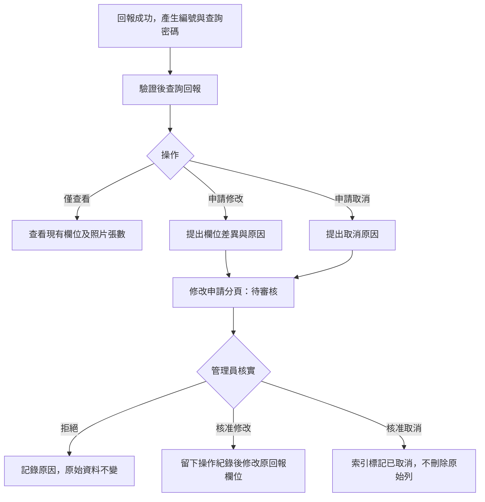
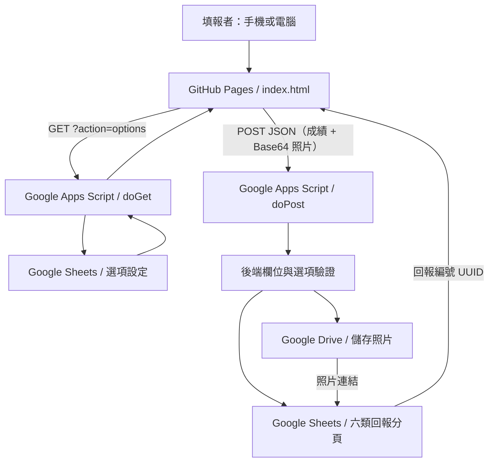

# 寶光崇正 2027 年（丁未年）白陽慈航盛會｜成績回報系統

> [!IMPORTANT]
> **目前為第一版開發原型（尚未驗收），不是正式上線公告。**
> GitHub 上有前端與後端**原始碼**，但尚未確認 Apps Script 正式部署與 GitHub 程式一致，也未完成所有六類回報、照片寫入及跨來源連線的端對端測試。請勿直接收集正式求道卡、出席表或其他個資。

> [!NOTE]
> **2026/11/12 最新欄位規則**：每種回報工作表只保留該類表單會出現的欄位，按照實際填寫順序排列；後端另保留「回報編號、送出時間、回報類別」三個追蹤欄位。需要照片的類別才會有「照片連結」欄。**舊版工作表不得直接與新版資料混寫**，請先備份並執行 `migrateReportSheets()`。

## 2026/11/12 12:57:07（台灣時間）｜修正一般回報者無法按「送出取消申請」

**使用者回報**：一般回報者在「查詢／申請修改」查詢成功後，開啟「申請取消回報」，無法正常按「送出取消申請」，看起來沒有任何反應。

### 修正內容（僅 `index.html`）

1. 將取消申請按鈕改為由 `click` 事件直接呼叫 `submitCancelRequest_()`，避免瀏覽器原生表單驗證在沒有清楚訊息時阻擋送出；同時保留 `submit` 事件供鍵盤操作，避免重複觸發。
2. 取消原因未填、去除空白後少於4字或超過500字時，顯示清楚的錯誤提示並聚焦原因欄位。
3. 未查詢、已有待審核申請、回報已取消、查詢密碼被清空時均顯示原因，不默默返回。
4. 送出前再次由回報者確認；送出期間按鈕停用，避免雙擊重複申請，並顯示送出中。
5. 成功後顯示「取消申請已送出，狀態：待審核」及申請編號；失敗時提示先重新查詢並核對待審核狀態，避免重送。
6. 每次成功查詢／刷新回報時重設取消申請欄位及狀態，避免殘留上一筆內容。
7. 後端仍使用既有 `action='changeRequest', changeType='cancel'`，**不會直接刪除回報或照片，也不會跳過管理員審核**。

**模擬測試**：前端 JavaScript 語法通過；未填原因、原因少於4字、使用者取消確認、合法送出、API 發生錯誤、已有待審核申請等6種情境均得到預期結果。模擬合法送出產生 `changeRequest` 及 `changeType='cancel'` 請求。未測試正式 Apps Script 網路請求或真實取消審核。

**GitHub 修改**：[7ae949a](https://github.com/chy0205/ikt1114/commit/7ae949a04d21b05597efeab842ccb22d2fbf959d)；2026/11/12 12:57:07（Asia/Taipei）。

**部署**：僅修改 GitHub Pages `index.html`，**不需要重新部署 Apps Script**；請重新整理網站或按 `Ctrl+Shift+R` 取得新前端。如仍無法送出，請查看畫面顯示的具體錯誤與後端執行記錄。

---

## 2026/11/12 11:35–11:39（台灣時間）｜五項系統改善與模擬驗證

**本節為目前最新功能說明。** 依管理員要求，完成以下五項改善，保留原本「新增成績、查詢／申請修改、區域負責人密碼查詢、管理員核准／拒絕、六類回報、Google Drive 照片」的流程。此次**只變更 GitHub 程式與本文**，沒有直接改動既有試算表回報、照片、密碼或任何管理員身分設定。

### 1. 密碼安全與權限保護

- `regionalAllowed_()` 保留以「選項設定」D 欄手動 KEY 的**每組至少6碼、同一格可多組密碼**及既有長密碼相容性；輸入的密碼仍只在 GAS 伺服端與授權區域比對，公開 `options` API 不含密碼。
- 新增 `regionalFailedThrottle_()` 與 `recordRegionalFailure_()`：保留原本**同一錯誤密碼 8 次／15 分鐘**限制，另加入 **全系統錯誤密碼 80 次／15 分鐘**的防濫用閾值。後者使用 GAS `CacheService`，**不是原子計數、也不是基於 IP 的精準限流**；大量異常請求可能讓正常使用者暫時被擋。建議正式上線時監控用量並評估更可靠的登入驗證及邊緣限流。
- 前端在離開「區域負責人查詢」分頁時會**清除本次區域密碼、統計和明細**；原本「清除畫面與密碼」功能保留。密碼不寫入網址、localStorage 或公開 GitHub。
- **仍然存在的重要風險**：使用者特別要求 D 欄明文、最低6碼，管理原始試算表的所有能讀 D 欄的人可取得密碼；此模式不能等同完整登入與權限控管。必須限制原始試算表存取權並使用長且難猜的密碼。

### 2. 成績、回報索引與照片的唯讀健檢

- 管理員在綁定試算表上方「**管理員工具 → 成績、索引與照片健檢…**」執行 `adminIntegrityCheckPrompt()`。
- 預設**唯讀**掃描六類工作表、回報索引並統計：有效回報筆數、索引筆數、**缺索引、孤立索引、重複編號、照片缺少連結、照片連結格式錯誤、欄位格式不符**。因歷史回報不一定有索引，健檢會列出異常供管理員核對，不會因此判定全部回報無效。
- 啟動時若選「**是**」，額外抽查最多**前50個照片檔案**，使用 `DriveApp.getFileById` 檢查是否可讀或已移入垃圾桶，**不建立、修改、共用或刪除照片**；選「否」只核對工作表及網址格式，不呼叫 Drive。
- 結果顯示彙總，最多150筆問題寫入 Apps Script 的 Logger（包含回報 UUID 和問題類型，請限制編輯器／記錄檢視權限）。**不自動修復資料、補索引、移動照片或新增試算表**。
- 此檢查受 `ADMIN_EMAILS` 白名單保護，未公開成匿名網頁 API。大型表單的檢查可能耗時，建議先在小資料／非尖峰時段測試。

### 3. 區域負責人修改申請進度查詢

- 公開 Web App 新增 `action='regionalRequests'`，**每次都要提交區域查詢密碼**。
- 後端先確定該密碼**實際授權**的國別、單位、區域，僅顯示對應原始回報 UUID 的修改／取消申請，回傳申請編號、回報編號、提出時間、申請類型、狀態（待審核／已核准／已拒絕）、申請原因、處理時間、審核說明。
- 不回傳「修改申請」工作表中的原始／變更 JSON、照片網址、管理員稽核或其他區域的申請。**每次最多列出最新200筆**，超出時顯示總數與截斷提醒。
- 前端「區域負責人查詢」新增 **「修改申請進度」** 區塊及「重新整理審核進度」按鈕。查詢成功後自動載入，成功送出新的修改申請後會再次更新；若進度查詢暫時失敗，會顯示錯誤，但不使已成功取得的成績消失。

### 4. 管理員審核介面改善

- Google 試算表「**管理員工具 → 審核修改／取消申請…**」會顯示**待審核總筆數、修改筆數、取消筆數**，並以申請時間由新到舊列出最新15筆。
- 選擇時可以直接輸入 **`1` 至 `15` 的序號**，不必複製長 UUID；也可輸入任何待審核申請的完整 UUID。
- 保留原本「查看修改差異 → 是＝核准／否＝拒絕／取消＝不處理 → 輸入審核說明 → 再次確認」，以及 `reviewChangeRequest()` 的管理員白名單、版本／快照比對、`LockService` 及操作紀錄。
- 模擬測試曾發現序號正規表示式轉義錯誤，已另外提交修正並**重跑核准／拒絕／取消**情境。這次沒有對實際「修改申請」表做任何審核操作。

### 5. 區域統計圖表與回報明細篩選

- 前端新增六種成績指標的**統計卡片與橫向長條圖**，可選「全部授權區域」或單一授權區域。**指標包含人數與筆數等不同單位，圖表明確警告不可將六類直接加總為同一指標**；已取消的回報仍不列入統計。
- 新增區域、回報類別、回報狀態及搜尋文字的**明細篩選器**；篩選只作用於該次後端已授權回傳的資料，無法用前端指定其他區域來繞過後端權限。
- 會顯示符合條件的總筆數，為避免大量 DOM 表格造成手機卡頓，**單次最多呈現前200筆明細**，超出時請縮小篩選。
- 無額外外部圖表程式庫，使用原生 HTML、CSS 和 JS；數值與名稱使用 `textContent` 顯示，避免將回報欄位當 HTML 執行。
- 保留原本成績彙整表、回報明細、單筆申請修改、密碼清除、「**申請完請聯絡劉點傳師**」提醒等既有功能。

### 程式提交與時間（Asia/Taipei）

| 台灣時間 | 檔案 | 更新內容 | GitHub |
| --- | --- | --- | --- |
| 2026/11/12 11:35:05 | `Code.gs` | 錯誤密碼額外防濫用、區域限定修改申請進度、唯讀成績／索引／照片健檢 | [cc632da](https://github.com/chy0205/ikt1114/commit/cc632dabf1cf2e96a155c188bc19d32b21aa7f44) |
| 2026/11/12 11:35:48 | `Code.gs` | 審核清單最新優先、分項計數、輸入數字選擇申請 | [062d17e](https://github.com/chy0205/ikt1114/commit/062d17e496e044a15eb34fdebb986e0253ec470a) |
| 2026/11/12 11:37:05 | `index.html` | 區域統計圖、明細篩選、修改申請進度查詢 | [fb8ef59](https://github.com/chy0205/ikt1114/commit/fb8ef592f9090cf8305b0eaa92aca37c6a2075db) |
| 2026/11/12 11:38:06 | `index.html` | 切換離開區域頁籤清除密碼、送出申請後自動刷新進度 | [7f2d2f1](https://github.com/chy0205/ikt1114/commit/7f2d2f1e8be430f0259517de590774864c41daaa) |
| 2026/11/12 11:39:43 | `Code.gs` | 修正審核序號辨識的正規表示式 | [7ceacb0](https://github.com/chy0205/ikt1114/commit/7ceacb0cc4222bb3eedfcd88d052e138b024bb3f) |

### 模擬測試證據與限制

**已通過**：
1. 前端 JS 與 Apps Script JS 語法解析；檢查 HTML 靜態 `id` 無重複，程式中缺少的靜態參考均為原本動態建構的回報／修改欄位或頁籤名稱。
2. 區域修改申請進度：使用兩個不同區域的假回報和假審核理由，正確只回傳有授權區域的一筆，**其他區域的 UUID、說明未洩漏**。
3. 資料健檢：假資料中一筆缺索引、一筆孤立索引及一筆缺少必填照片連結均正確列出，**原始測試陣列前後內容完全相同**，且沒有新增／刪除／覆寫資料。
4. 密碼限流：模擬82次不同錯誤密碼，前80次拒絕並計數，第81、82次進入全域限流；未把密碼原文存於快取鍵。
5. 管理員審核：模擬序號 `1`，核准呼叫 `approve`、拒絕呼叫 `reject`；取消操作**不呼叫審核函式**。
6. 統計圖表與明細篩選：以兩個假區域和不同回報狀態模擬 DOM，全部授權區域的六類數值為 **13／4／2／3／3／1**；切換只看第一區後，數值為 **3／4／0／1／0／1**；明細只留下第一區的測試回報，未混入第二區。前端 JS 同時通過語法、節點及路由靜態檢查。**正式手機視覺呈現仍須瀏覽器實測**。

**尚未進行**：正式 Apps Script 部署、真實 Google OAuth／Drive 檔案抽查、實際修改／核准資料、在不同網路或裝置上的效能／權限滲透測試。**不能將模擬測試視為正式系統已部署驗收。**

**部署注意**：這次有新增 `Code.gs` 的公開 `regionalRequests` 路由，因此網站前端雖已提交 GitHub，仍必須由管理員將**最新版完整 `Code.gs`** 複製到原本 Apps Script 專案，並在「部署 → 管理部署作業」將**原有相同部署 ID** 指向「新版本」。否則新頁面的修改申請進度會顯示「不支援的操作」，但既有功能可能仍可使用。若管理員選單沒有出現，請核對腳本是否綁定正確的 Google 試算表。

---

## 修正區域負責人舊回報無法申請修改｜2026/11/12 11:24:43（台灣時間）

**使用者實際畫面**：在「區域負責人查詢 → 申請修改區域回報」選擇既有回報後，點「載入回報資料並申請修改」，出現 **「找不到可修改的回報索引，請聯絡管理員」**。

### 根因已核實

實際試算表的原始回報分頁已有多筆資料，但「回報索引」只有少數有對應的 UUID 記錄。舊版回報可被區域查詢列在明細裡，卻因 `regionalReport_()` 強制要求有 `findIndex_()` 而無法載入修改表單。**這與查詢密碼是否設定多組、或使用者輸錯密碼不是同一問題**。

### 後端修正

1. 新增 `regionalReportSource_(id, idx)`：有索引的回報依索引類型尋找，無索引則只搜尋現有六類回報分頁，必須找到**唯一**原始回報；有多筆同 UUID 或不存在即拒絕。
2. `regionalReport_()`：即使沒有索引，仍可在驗證區域密碼、原始回報確實屬授權國別／單位／區域後回傳可編輯欄位；舊回報呈現 `version:0`、`status:'已回報'`，但**讀取階段不修改工作表**。
3. `regionalChangeRequest_()`：持有 Script Lock 的寫入流程再次驗證區域密碼、授權區域、是否已有待審核申請、舊回報版本與欄位合法性；真正提交有效修改申請時才為無索引舊回報**補建「回報索引」**（隨機鹽與密碼雜湊，版本1，狀態已回報），同時新增一筆「操作紀錄」備註。**不更動原始成績列、照片網址、照片檔案**。修改申請照舊寫入「修改申請」分頁，等待管理員審核。
4. 自動補建的憑證**不向區域負責人公開，也不將明文密碼存入工作表／記錄**；若原回報人未來需要個別查詢密碼，須經管理員確認身分後使用現有重設密碼程序。
5. 禁止修改國別、單位、區域及照片的既有約束不變；沒有授權的區域、已有待審核申請、對應多筆或無法找到原始回報均不補索引、不寫入申請。

### 測試與部署

- 模擬測試通過：**無索引但確有原始資料**可載入並成功寫入1筆新索引＋1筆待審核申請＋1筆補建稽核；**非授權區域、已有待審核申請、同 UUID 對應不唯一**，全部拒絕且無新增紀錄。JavaScript 語法解析通過。
- **沒有直接執行正式試算表寫入、照片變更、Apps Script 線上測試**。正式環境使用前請先備份，並以測試資料確認。
- 把 GitHub 最新 `Code.gs` 複製到**目前網站 API_URL 指向的 Apps Script 專案**，儲存，再到「部署 → 管理部署作業」將**原本相同部署 ID** 編輯成新版本後部署。只更新 GitHub 不會讓原本 /exec 自動更新。
- 前端 `index.html` 這次不必修改，仍在「區域負責人查詢」頁面使用既有「載入回報資料並申請修改」按鈕。
- 如果部署後仍出現舊的「找不到可修改的回報索引」錯誤，先確認部署是否仍指向舊版 GS；新版這個讀取錯誤已移除。
- 與原本「選項設定」D 欄可填多組至少6碼密碼的功能完全相容。

**提交紀錄**：[5ae8c9d](https://github.com/chy0205/ikt1114/commit/5ae8c9d0553966e3db6af55dda3698f1aff9c55c)，2026/11/12 **11:24:43**（Asia/Taipei）。

---

## 選項設定同一區域多組密碼｜2026/11/12 11:19（台灣時間）

**需求**：「選項設定」D 欄「密碼」或「區域查詢密碼」中，**同一列可能同時有兩、三組不同密碼**；任一組密碼都應可查該列區域的成績及送出修改申請，不需要新增更多欄位或複製整列。

**最新格式示例（皆為假密碼，勿作正式使用）**：

| A 國別 | B 單位 | C 區別 | D 密碼 |
| --- | --- | --- | --- |
| 台灣 | 中和 | 中和001 | `abc123, xyz789, third456` |
| 台灣 | 中和 | 中和002 | `xyz789；another456` |
| 台灣 | 中和 | 中和003 | `single444` |

D 欄可用 **半形逗號 `,`、全形逗號 `，`、半形分號 `;`、全形分號 `；`、儲存格內換行** 分隔不同密碼；混用也支援。每一組密碼獨立計算，長度仍為 **6～128 字**，同一個 D 欄儲存格最多 **20 組**；原本只填單一密碼的格式不需更動。

- 輸入 `abc123`：只可查看中和001；輸入 `xyz789`：可同時查看中和001及中和002。
- 輸入 `third456`：可查看中和001；`single444`：可查看中和003。
- 輸入不足6字、或只輸入密碼一部分，不能通過驗證。
- 此功能維持**後端比對真實儲存格內容並限定區域**，不將 D 欄密碼送出至前端 `action=options`；區域負責人仍只能申請修改自己有授權的回報，交管理員審核。
- 以分隔字元作為多組密碼區隔，因此**每組密碼本身不可含 `,`、`，`、`;`、`；` 或換行**；請用英數混合或其他不衝突字元。建議使用較長強密碼，6碼容易被猜。
- D 欄仍是**明文**，請限制原始成績試算表查看權限，不要提供給各區負責人直接讀取。

**程式更新**：僅修改 `Code.gs` 的 `optionPasswordRegions_()`，將同一儲存格的密碼按分隔符拆開逐組比對，保留既有 `密碼`／`區域查詢密碼` 表頭相容性、六碼下限、舊版64碼憑證與區域授權範圍；`index.html` 無須更動。

**測試**：已通過 JavaScript 語法檢查與模擬表格測試：逗號、分號、換行、跨列同密碼、舊版單一密碼均可辨識；不足6碼與部分密碼不可通過；沒有修改真實試算表內容。**尚未在正式 Apps Script 部署完成端到端測試**。

**GitHub 紀錄**：
- 2026/11/12 **11:19:31** — [2ec9c08](https://github.com/chy0205/ikt1114/commit/2ec9c0813b61bfeb430f332fca30a89c77b0edcb) 新增同儲存格多組密碼處理。
- 2026/11/12 **11:19:57** — [3de67a6](https://github.com/chy0205/ikt1114/commit/3de67a6d82fc2665be54038053538d7bbe1f32f2) 修正換行分隔的正規表示式並重新測試。

**部署**：管理員必須將最新版 GitHub `Code.gs` 複製到網站對應的 Apps Script 專案，於「部署 → 管理部署作業」選擇原部署的**新版本**重新部署，前端才會支援同一列多組密碼。

---

## 前端聯絡提醒調整｜2026/11/12 11:13:43（台灣時間）

- 依使用者要求，將「區域負責人查詢」頁面原本的 **「檢查後端部署版本」** 按鈕及結果區塊改成醒目的靜態提醒：**「申請完請聯絡劉點傳師」**。
- 同時移除前端不再使用的健康檢查按鈕事件與 JavaScript 函式，避免找不到 DOM 按鈕造成前端初始化錯誤。
- **僅更動 `index.html`；沒有更動 `Code.gs` 的 API／授權／修改申請流程**。後端的 `GET ?action=health` 仍可供管理者直接使用，但不再於前端提供按鈕。
- 已使用 JavaScript 語法解析驗證前端腳本可載入；尚未在正式瀏覽器及實際 GAS 完整驗收。
- [前端修改 Commit](https://github.com/chy0205/ikt1114/commit/b9cab8d164b7cf31552df3ecbbb0c59c5eeb567c)，台灣時間 **2026/11/12 11:13:43**。

---

## 2026/11/12 10:51｜全站區域查詢故障排查：不支援的操作／密碼欄標題

**使用者回報**：已重新部署卻仍在前端「區域負責人查詢」看到「不支援的操作」。本次分別檢查 GitHub 前端 `index.html`、後端 `Code.gs`、原始 Google Sheets 工作表中「選項設定」實際表頭，以及部署版本識別方式。

### 實際核對結果

1. **前端**：原本網站的區域查詢是 `POST` 到 `API_URL`，內容 `action:'regionalLookup'`；區域申請修改另用 `regionalReport` 及 `regionalChangeRequest`。API_URL 目前指向同一個舊有 `/exec` 部署 ID，不會因為 GitHub 改動就自動同步後端。
2. **GitHub 後端**：`doPost` 已有三個區域操作路由，不是 GitHub 原始碼缺少分支。因此若**網站仍回傳原始的「不支援的操作」**，最可能是線上 `/exec` 的部署版本不含新分支，或網站連到另一個 Apps Script 部署。**目前無法透過現有連線工具直接取得使用者 Apps Script 部署內容與目前部署版本，不可宣稱已確認線上版本。**
3. **試算表**：「選項設定」實際 D1 是 **`密碼`**，與舊程式只接受 `區域查詢密碼` 不符；此問題會讓新的後端無法認得現有手動密碼。已修正為**兩種表頭都接受**，不要求更改實際試算表。
4. **選項資料**：檢查 A2:D120 範圍，共有 59 列，D 欄 1 列非空白，該密碼長度為 7 字，符合至少 6 字規則。**為保密，沒有將明文密碼記入 GitHub、記錄或回覆，也沒有更改密碼及任何資料列。**
5. **安全**：公開 `action=options` 仍只回傳 A～C 三欄的國別、單位、區域，絕不回傳 D 欄密碼。

### 本次修正

- `Code.gs` 的 `optionPasswordRegions_()` 相容 `D1='密碼'` 與 `D1='區域查詢密碼'`。
- 新增不需密碼的 `GET ?action=health` 診斷回覆，包含 `build:'regional-change-20261112-v2'` 和支援操作名稱；**不包含 Google Sheet 資料、密碼、授權範圍或密碼雜湊**。
- `doPost` 若碰到不存在的操作名稱，現在會顯示該操作名稱與提示檢查版本，協助區分路由問題。
- `index.html` 的「區域負責人查詢」新增 **「檢查後端部署版本」** 按鈕；檢查會顯示目前線上 `/exec` 是否回傳預期的 `build`。若顯示「未提供版本資訊（舊部署）」就代表現有 `/exec` 沒有這次的新版健康檢查程式。
- 發生「不支援的操作」時，前端將引導先檢查後端部署版本，而不是把問題誤判為密碼錯誤。

### 管理員如何修復

1. 在 [GitHub 取得最新 Code.gs](https://github.com/chy0205/ikt1114/blob/main/Code.gs)，確認包含 `API_BUILD='regional-change-20261112-v2'` 及 `regionalLookup_`、`regionalReport_`、`regionalChangeRequest_`。
2. 開啟**前端 API_URL 所指向的原始 Apps Script 專案**。如果正在使用試算表「擴充功能 → Apps Script」，要確認那就是網站原有 `/exec` 的部署專案，否則同步到另一個專案無法更新網址中的版本。
3. 將整份 `Code.gs` 同步儲存到正確專案。
4. 到「部署 → 管理部署作業」，**找出部署 ID 與前端 `API_URL` 完全相同的網頁應用程式**；選擇鉛筆編輯，版本選「新版本」，再按「部署」。保留相同 `/exec` 網址。
5. 網站強制重新整理，進入「區域負責人查詢」，按「檢查後端部署版本」：必須看到 `regional-change-20261112-v2`，才表示部署和本次 GitHub 程式一致。若沒有版本資訊，先檢查是否選錯部署 ID 或選成舊版本。
6. 再用測試密碼查詢；如果版本相符但資料查詢仍失敗，請至 Apps Script 執行記錄查看失敗原因，核對選項設定 D1、D 欄最少 6 字及是否有對應的 A～C 地點。
7. 若 Apps Script 使用獨立型專案，試算表的管理員 UI 選單需另由綁定腳本提供，但**公開網站的 `/exec` 仍需對應正確後端部署**，兩者不是同一回事。

### 檢驗與限制

- **模擬測試成功**：前後端 JavaScript 語法檢查；D1 為「密碼」或「區域查詢密碼」均可辨識指定區域；錯誤密碼拒絕；公開 `options` 回應不含密碼。
- **線上部署仍未核實**：Google Apps Script 的部署管理頁面、版本號以及真實 `/exec` 的 API 回覆無法由目前取得的工具確認。沒有聲稱完成線上修復。
- **原始成績及照片**：本次只更動 GitHub `Code.gs`、`index.html`、`README.md`，未更動 Google Sheets 任何資料、密碼或 Drive 照片。

| 修改時間（Asia/Taipei） | 內容 | GitHub Commit |
| --- | --- | --- |
| 2026/11/12 **10:51:06** | `Code.gs` 相容實際 D1 表頭並新增安全健康檢查 | [db54968](https://github.com/chy0205/ikt1114/commit/db5496819f52657e9c9ad24f4702881ce4c749be) |
| 2026/11/12 **10:51:46** | `index.html` 增加部署版本檢查按鈕與錯誤引導 | [667ca56](https://github.com/chy0205/ikt1114/commit/667ca5692be046ee4b2cc567196307266d61c8b5) |

---

## 區域負責人可申請修改回報｜2026/11/12 10:37–10:38（台灣時間）

**最新功能**：區域負責人在原本公開網站「區域負責人查詢」輸入「選項設定」D 欄的區域密碼（至少 6 碼，亦相容既有有效區域憑證），讀取自己有權限的區域成績後，現在可以從明細中選擇一筆紀錄，載入可編輯欄位，填寫原因並送出**修改申請**。**申請不會直接覆蓋正式成績**，管理員須在「管理員工具 → 審核修改／取消申請…」核准後才會生效。

### 網站操作

1. 負責人在 [白陽慈航2027網站](https://chy0205.github.io/ikt1114/) 開啟「區域負責人查詢」，輸入所負責區域的查詢密碼並查詢。
2. 成績彙整、回報明細下方有新區塊 **「申請修改區域回報」**。
3. 在選單中選擇要修改的**單筆回報**，按 **「載入回報資料並申請修改」**。
4. 系統再次在伺服器核對密碼、資料的真實區域及回報狀態，再載入該類別的可編輯欄位。
5. 更正資料、填寫 4～500 字修改原因，確認後按 **「送出修改申請」**。
6. 成功後顯示申請 UUID 與「待審核」，管理員至既有「修改申請」分頁與審核視窗查看。管理員核准後，使用者再重新查詢即可看到更新。
7. **只能申請修改**：區域負責人不可直接刪除、取消回報、核准／拒絕申請、重設其他人密碼或修改照片。

### 權限、審核與資料安全

- 新增後端只讀 `action='regionalReport'`：須提供區域密碼與完整回報 UUID；後端會從「回報索引」找出真實類別、在原始表確認國別、單位、區域三項全部與密碼授權範圍相符，才回傳欄位、版本、狀態、照片張數與待審核狀態。**不返回照片連結、個別回報查詢密碼或密碼雜湊。**
- 新增後端 `action='regionalChangeRequest'`：再次比對同筆 UUID、真實區域、憑證是否仍有效，並在持有 ScriptLock 時**重新驗證一次授權**；如果管理員已改動「選項設定」D 欄使舊密碼失效，不能再用舊密碼送申請。
- **禁止變更 `country`、`unit`、`district`**：區域負責人不能透過更改回報歸屬跨區送申請。若確實填錯區域，請聯絡管理員人工處理。
- **禁止直接改照片或要求取消整筆**。若要更換求道卡、出席表、安堂照片，請聯絡管理員核實與處理。
- 已取消的回報、找不到索引的舊版回報、版本過期或**已有待審核申請**者都無法重複送出修改。
- 非授權區域的 UUID 即使被猜到或由他人提供，也無法讀取詳細資料或送出修改申請。
- 原本的 `validateChange_()` 仍負責驗證欄位、日期、人數與選項，修改申請會寫入現有「修改申請」分頁並在申請原因標註 **`[區域負責人申請]`**，讓管理員辨識來源。
- **管理員審核流程不變**：核准、拒絕由已授權管理員在 Google 試算表執行；核准後才改動正式資料並留下「操作紀錄」。
- 網站於查詢成功後在目前瀏覽器的記憶體暫存區域密碼，以便接續申請修改；密碼不會被寫入網址或瀏覽器永久儲存。按「清除畫面與密碼」會清除；使用公共電腦時操作完成務必清除並關閉頁面。
- 「選項設定」D 欄仍是明文密碼，且至少 6 碼相對容易猜測，**原始試算表不可分享給區域負責人**；正式使用建議採更強密碼、限制原始表存取權限並測試風險。

### 更新提交與驗證

| 台灣時間 | 檔案 | 內容 | Commit |
| --- | --- | --- | --- |
| **2026/11/12 10:37:16** | `Code.gs` | 抽出 `regionalAllowed_()` 共用權限驗證；新增 `regionalReport_()` 單筆授權查詢及 `regionalChangeRequest_()` 待審核修改申請入口 | [6fc9654](https://github.com/chy0205/ikt1114/commit/6fc9654d7e4797c76a0b5c2dddc90dae493c3ba1) |
| **2026/11/12 10:38:09** | `index.html` | 區域負責人前端加入挑選單筆回報、載入原始欄位、輸入更正內容與原因、送出申請 | [ebe6f8e](https://github.com/chy0205/ikt1114/commit/ebe6f8e690ede4a03172fa8ebe0c558c85939105) |
| **2026/11/12 10:38:40** | `index.html` | 修正完成一筆申請後，重新選擇其他紀錄仍能繼續操作的按鈕狀態 | [ddc7f99](https://github.com/chy0205/ikt1114/commit/ddc7f99137a0137d0fad977c20560f5a8c40d264) |

**已執行**：前後端 JS 語法檢查；以模擬管理工作表及區域授權檢查四種場景：合法區域申請會加入一筆待審核、非授權區域拒絕、已有待審核申請拒絕、已取消回報拒絕。**沒有執行實際 Google Apps Script / Google Sheets 的端對端測試，也沒有更動現有真實回報資料**。

**部署步驟**：已更新 GitHub 前端，但必須把最新 [Code.gs](https://github.com/chy0205/ikt1114/blob/main/Code.gs) 複製進原 Google Apps Script 專案、確認授權、部署新版本（使用原本 /exec 部署網址），才能在公開網站成功執行新功能。切勿以測試版結果宣稱已正式上線驗收。

---

## 區域查詢密碼長度調整｜2026/11/12 10:34:41（台灣時間）

**最新規則：**「選項設定」分頁 D 欄的「區域查詢密碼」由先前**至少 12 碼**改為 **至少 6 碼、最多 128 碼**，方便管理員直接 KEY。原本個別回報者使用的「回報編號＋隨機查詢密碼」機制、管理員審核、六類回報功能均不變。

- D 欄只要輸入 6 碼以上，後端即可接受；例如 `aB7x9Q` 僅為格式示例，請勿拿來當正式密碼。
- 相同密碼出現在多個區域的 D 欄，仍會顯示所有對應區域的成績；其他區域不會外洩。
- 少於 6 碼、空白或以 `=` 開頭的 D 欄內容不予啟用。原本有效的 12 碼以上密碼維持有效。
- **安全提醒：6 碼更容易被猜測**，尤其密碼以明文儲存在試算表。建議實際使用仍設定長度較長、混合字母數字、且不同負責人不共用的密碼；原始試算表的存取權限只能給可信任管理員。
- 公開 `GET ?action=options` 仍只回傳國別、單位、區域，不回傳 D 欄密碼。
- **修改範圍：只有 `Code.gs` 的密碼長度驗證與相關註解**，`index.html` 不必更動，沒有直接修改真實 Google 試算表。

**Commit：** [21db189](https://github.com/chy0205/ikt1114/commit/21db18924618d862990991b1d24d5c09ac1db5e7)；台灣時間 **2026/11/12 10:34:41**。

**測試結果：** JavaScript 語法通過；以模擬「選項設定」驗證 6 碼密碼可取得兩個對應區域，5 碼及錯誤密碼無法取得任何區域。**尚未在正式 Apps Script 線上環境驗收**，需複製最新版 `Code.gs` 至 Apps Script 並部署新版本後才會生效。

---

## 最新：選項設定 D 欄直接 KEY 區域密碼｜2026/11/12 10:31（台灣時間）

**使用者最終指定的操作方式：** 管理員可在原本 Google 試算表的「選項設定」分頁直接輸入、複製、修改各區域的查詢密碼，不需每個負責人重新由選單產生隨機查詢密碼。

### 一、工作表格式

| A 國別 | B 單位 | C 區別 | D 區域查詢密碼 |
| --- | --- | --- | --- |
| 台灣 | 中和 | 中和001 | `example-strong-key-001` |
| 台灣 | 中和 | 中和002 | `example-strong-key-001` |
| 台灣 | 中和 | 中和003 | `example-strong-key-003` |

以上密碼為**示意字串，請勿直接用於正式環境**。A～C 欄完全沿用原本選項設定，不需搬動或刪除資料。**D1 必須精確填入 `區域查詢密碼`**。最新版後端的 `setupSheets()` 會在 D1 空白時自動補上標題，不會覆蓋已有的 D1。

- 同一個密碼可以填在多個區域的 D 欄，輸入密碼後就能查閱所有對應區域的六類成績及明細（最多 100 個不同區域）。
- 不同密碼對應不同區域，不會因為國別或單位相同就自動取得其他區域資料。
- D 欄空白代表**不授權此區域的手動密碼查詢**；沒有密碼不會開放查詢。
- D 欄密碼**至少 12 字，最多 128 字**；請設定難猜、彼此不同的高強度密碼，避免直接使用區名、電話、生日或簡單流水號。
- 若需要停止某區域密碼，直接清空或更換該列 D 欄；下一次網站查詢就會按照最新設定執行，不需重新部署。
- 若相同密碼同時用於其他區域，清空其中一列只取消那列的查詢權限，不影響同密碼授權的其他列。

### 二、實際使用

1. 管理員開啟 Google 試算表「選項設定」分頁，確認 D1 標題為 `區域查詢密碼`。
2. 在每個希望授權的區域對應 D 欄**直接 KEY 密碼**；如一人負責多個區域，就在這些區域填相同密碼。
3. 將該組密碼**私下**傳給對應的區域負責人。
4. 區域負責人在原本網站切換「區域負責人查詢」，輸入密碼，立即查詢後端允許的區域明細及成績彙整。
5. 變更 D 欄內容後，下次查詢立刻依更新後的密碼比對，不需要管理員核發新憑證或另建檢視表。

### 三、安全與現有限制（務必閱讀）

**這是方便手動管理的「明文密碼」方案，安全性不如前一版分開儲存雜湊。**

- **原始 Google 試算表內可查看「選項設定」分頁的人，可能直接看到 D 欄所有區域密碼**；不能只靠隱藏／保護工作表達到保密。請**嚴格限制整份原始試算表**的檢視與編輯權限，**絕不分享原始試算表給區域負責人**。
- 網站原本 `GET ?action=options` 只回傳 A～C 的 `country`／`unit`／`district`，**不回傳 D 欄**。D 欄只會在後端 `regionalLookup_` 驗證時讀取。
- 後端透過加上伺服器密鑰的摘要值比較輸入與 D 欄密碼；不記錄明文密碼到操作紀錄或網址。該保護**不等於 D 欄已加密**；工作表內仍是明文。
- 為避免誤用既有的其他 D 欄資料，只有 **D1 恰好等於 `區域查詢密碼`** 才會啟用手動密碼查詢，否則會視為未設定。
- 目前仍相容之前核發的 64 位查詢密碼（舊版「區域查詢授權」分頁有效憑證仍可查詢）；如果要徹底停用舊密碼，請使用原本管理員停用功能，而不是只改 D 欄。
- 密碼查詢屬**唯讀**：無法藉此修改、取消、審核或查看原始照片連結。
- 此系統仍沒有完整的全域請求限流、綁定 Google 帳號或密碼遺失恢復系統；對含姓名等資料的區域報表，仍建議正式上線前增加驗證與安全測試。

### 四、修正程式、時間與測試

| 台灣時間 | 修改 | Commit |
| --- | --- | --- |
| **2026/11/12 10:31:26** | `Code.gs`：讀取「選項設定」D 欄，支援管理員直接 KEY 12～128 字密碼、多列同密碼對應多區；保留舊版憑證驗證及後端範圍控制 | [176eef9](https://github.com/chy0205/ikt1114/commit/176eef9a8b67e5a5480cd053c65576ed1848b15e) |
| **2026/11/12（後續修正）** | `Code.gs`：`setupSheets()` 在 D1 空白時安全補入 `區域查詢密碼` 標題，且查詢只在 D1 相符時啟用 | [c65735e](https://github.com/chy0205/ikt1114/commit/c65735efdf6742b4ebbc309377ac0644a429e713) |

**已測試（模擬）**：語法解析成功；以 4 筆測試選項模擬，相同密碼可對應三個指定區域，另一組密碼對應一個區域，錯誤密碼對應零個區域。**尚未在正式 Google Apps Script 及實際試算表完成端對端驗收**，本次沒有直接更動已存在的選項設定、六類回報資料，也沒有在你的真實試算表填入任何密碼。

**正式部署前**：管理員需同步最新版 GitHub `Code.gs` 至實際 Apps Script、完成 OAuth 授權並重新部署 Web App；D1 標題和 D2 起的密碼可自行直接 KEY。前端 `index.html` 沿用上一版「區域負責人查詢」入口，無須更改。

---

## 區域負責人「前端輸入密碼查詢」｜2026/11/12 10:26（台灣時間，最新規格）

**以本節為準，取代上方歷史版本中的「另建 Google 試算表給負責人」流程。** 使用者已明確指定：直接在原本 `index.html` 網站新增「區域負責人查詢」功能，輸入**管理員核發的密碼**後，顯示該密碼有權限查看的**全部對應區域**（一組密碼可授權 1 個或多個區域），不必另開檢視試算表。

### 新版使用流程

1. **管理員**在與原始試算表綁定的 Apps Script 更新最新版 [Code.gs](https://github.com/chy0205/ikt1114/blob/main/Code.gs)，並確認 `ADMIN_EMAILS` 白名單及 `LOOKUP_PEPPER` 已設定；重新整理試算表。
2. 在「管理員工具」選擇 **「核發區域負責人查詢密碼…」**，輸入欲授權的國別／單位／區域，一行一個，格式 `台灣/中和/中和001`；同一個負責人需要多個區域可輸入多行。
3. 系統會先核對全部區域是否存在於「選項設定」，再由管理員確認核發；產生 **64 位隨機十六進位密碼**以及授權編號。密碼只會於核發成功視窗顯示一次，應私下安全交付對應負責人。
4. 密碼僅儲存專屬鹽值及加上伺服器密鑰的雜湊，**不在 Google 試算表留明文密碼**。相關資料存於原始（不對外分享的）試算表新分頁「區域查詢授權」：A 憑證編號、B 鹽值、C 密碼雜湊、D 允許區域 JSON、E 狀態、F 建立時間、G 更新時間、H 核發管理員。
5. **區域負責人**進入既有 [成績回報網站](https://chy0205.github.io/ikt1114/)，點首頁第三個入口 **「區域負責人查詢」**，輸入剛才收到的密碼，按「查詢授權區域成績」。
6. 後端以密碼查到允許的區域清單，依 **國別、單位、區域** 三欄完整比對從六種原始回報中擷取資料，回傳已授權區域的彙整及明細；前端顯示授權區域、彙整表及明細表。**前端不能傳其他區域來擴大授權**。
7. 不顯示照片 Drive 連結、求道卡照片、原始個別回報查詢密碼／雜湊、管理員稽核紀錄；回報明細仍包括姓名、佛堂名稱等內容，請妥善保護區域密碼。
8. 若密碼外洩、不再任職，在試算表「管理員工具 → 停用區域查詢密碼…」，輸入當初的授權編號並確認，該密碼就無法再查詢。需要調整區域範圍時，請**停用舊憑證，再重新核發**。
9. 資料會於**每次查詢時直接讀取原始 Google 試算表**，不需要手動更新區域報表檔案。取消回報保留明細，但不計入彙整。
10. 首次使用前請由管理員確認 Google Drive／Apps Script 授權與新後端部署正常，並用不含個資的測試資料確認「只能查到授權區域」。

### 重要區別與安全性

- 原本「回報編號＋查詢密碼」供**個別回報者**查詢或申請修改，跟區域負責人密碼**完全分開**，不能共用。
- 區域負責人功能是**唯讀**，沒有修改原始成績、取消回報、審核申請、重設其他人密碼等權限。
- 管理員核發、停用功能不在公開 API；管理員仍須通過 `requireAdmin_()`，只有授權查詢 `action='regionalLookup'` 接受公開 Web App 請求。
- 密碼透過 POST 傳遞，沒有放入網址；後端使用隨機鹽＋SHA-256＋`LOOKUP_PEPPER` 雜湊比對，並對同一錯誤密碼加上快取嘗試限制。**這不是完整全域限流或身分登入系統**，若需更嚴格管控應再加入實名 Google 登入／專屬管理平台。
- 指定區域工作表的表頭與版本若不符，後端會停止，不會冒險把錯位資料洩漏給負責人。
- 前一版 `makeDistrictView_()` 等「另建唯讀 Google 試算表」輔助程式仍留作歷史相容，但已從管理員選單移除；**目前應使用前端密碼查詢，不需另外產生或分享檔案**。
- `區域查詢授權` 分頁含憑證雜湊與授權區域清單，須限制原始整份試算表存取權；不能只靠「隱藏分頁」保護。
- 仍需定義組織內哪些欄位應向區域負責人開放。目前明細可見姓名、佛堂名稱、人數、日期與照片張數，不包含照片內容。如果不希望負責人查閱姓名，需要再縮減欄位。
- **此次沒有直接新增真實憑證、修改正式工作表資料、授予任何人存取權限或部署 Apps Script。**

### 這次更新

| 日期時間（台灣） | 內容 | Commit |
| --- | --- | --- |
| 2026/11/12 **10:26:11** | `Code.gs` 新增「區域查詢授權」資料表、管理員核發／停用密碼、`regionalLookup` API，以及受權區域清單的後端範圍過濾 | [334ac1f](https://github.com/chy0205/ikt1114/commit/334ac1fa4e44b9f3a58125b82fdc5bf930abad70) |
| 2026/11/12 **10:26:55** | `index.html` 新增第三個首頁入口「區域負責人查詢」、密碼輸入欄、區域彙整／明細表及清除功能 | [b9ef648](https://github.com/chy0205/ikt1114/commit/b9ef648116ea6571b7271e0479fde21fc3e595ca) |

**已檢查**：後端及前端 JS 語法；以模擬密碼與資料測試，合法密碼只使用伺服器授權的區域（即使前端另帶其他區域也被忽略），錯誤密碼被拒絕。前一次單區功能的模擬也證明不會混入其他區域或照片網址。

**待測與部署**：實際 Apps Script Web App 同步與重新部署、與原始試算表綁定的管理員核發對話框、真實密碼比對、所有授權區域的多區查詢、錯誤密碼限流、實際手機顯示、撤銷後登入失敗，以及任何與個資相關的端對端安全驗收。GitHub Pages 的新版 `index.html` 可公開顯示第三個入口，**但正式 GAS 沒有更新以前不能正常查詢**。

---

## 區域負責人專用報表｜2026/11/12 10:20–10:21（台灣時間）

**最終需求（以本節為準）**：每位區域負責人只需要看**自己「國別＋單位＋區域」那一個區域的報表**，不是所有區域的合併報表，也不需要整份正式成績試算表的檢視／編輯權限。

### 本次調整過程

| 時間（台灣） | 內容 | GitHub Commit |
| --- | --- | --- |
| 10:20:05 | 首次加入供區域負責人查看的獨立彙整報表原型（當時包括全部區域，**已被下一個修正取代，不應部署該版本**） | [d44b612](https://github.com/chy0205/ikt1114/commit/d44b612402048c90949e85acc78936e308472ce4) |
| 10:21:21 | 按照使用者補充需求，**改為只輸出指定單一區域**，移除先前全區合併的輸出函式，新增區域驗證、獨立檔案與資料隔離 | [e2f4993](https://github.com/chy0205/ikt1114/commit/e2f4993a3c6078ceb0d298910ec24813f68f52bc) |

### 報表資料範圍與內容

- 指定完整 **「國別／單位／區域」**，例如：台灣／中和／中和001；只有三項完全一致的回報紀錄會進入該區檢視表。
- 檢視表是**獨立新建的 Google 試算表**，不會把原本「白陽慈航成績回報」工作表或回報索引分享出去。
- 新檔包含「檢視說明」、「區域彙整」、「回報明細」三個分頁。
- 區域彙整依原本六類分別計算「個人渡眾人數、家堂渡眾人數、公堂渡眾人數、個人成全進階班回報筆數、公堂進階班達標人數、完成安堂筆數、有效回報總筆數」。**注意各欄單位不同，不能直接把人數、筆數加總為同一指標。**
- 區域明細包含回報編號、送出時間、類別、國別、單位、區域、狀態、日期、人數／達標數、部分表單資料、照片張數等；**不包含照片實際 Drive 網址、求道卡圖片、查詢密碼或雜湊、管理員操作紀錄**。
- 在「回報索引」已標為「已取消」的回報仍保留明細以供核對，但**不納入有效彙整**。歷史未建立查詢索引的紀錄會標示「舊版未建立查詢憑證」，仍暫納入彙整；正式頒獎前須核實。
- 僅輸出存在於正式六類回報工作表的既有資料；不改動任何原始回報列。

### 如何建立區域專屬報表

1. 在**與原始成績試算表綁定的 Apps Script 專案**更新 GitHub 最新 [Code.gs](https://github.com/chy0205/ikt1114/blob/main/Code.gs)，並儲存；確保管理員信箱已納入 Script Properties 的 `ADMIN_EMAILS` 白名單。
2. 重新整理原始成績試算表，開啟 **「管理員工具 → 建立／更新單一區域報表…」**。
3. 依序在三個彈出視窗輸入原本「選項設定」分頁內的**完整國別、單位及區域**。系統會核對三者的組合，未在選項設定的區域會拒絕建立。
4. 首次建立會在管理員 Google Drive 產生只含該區資料的專用檔案；日後用**相同三項名稱**再執行，會更新同一份檔案。新建檔案時系統**不會自動分享**。
5. 完成後到 Apps Script「執行記錄」取得 **該區域專用試算表網址**。在新檔的「共用」設定中，**只加入該區域負責人的指定 Google 帳號**，權限設為**檢視者（Viewer）**；「一般存取權」維持**限制存取**，不要設成「知道連結的任何人」。
6. 負責人只看該區的「區域彙整」和「回報明細」。如有最新回報／核准修改／核准取消，**需管理員再次執行建立／更新功能才會同步**；目前未設定自動定時同步。
7. 若要提供另一區負責人，重新選擇**另一個完整的國別／單位／區域**，建立另一份獨立檢視表並各自設定分享權限。**絕不可把其他區檔案或原始試算表錯分享給本區負責人。**

### 安全與保護

- 只有通過 `requireAdmin_()` 的管理員才能呼叫 `makeDistrictView_()` 或操作建立／更新視窗；管理員函式沒有公開 Web App 路由。
- 會檢查工作表欄位格式，確認每筆紀錄的完整區域三段鍵值吻合後才放進輸出；避免將 A 區的資料誤放到 B 區。
- 每區檢視表的 ID 以專屬雜湊鍵存入 Script Properties。更新時確認檔案的隱藏識別標記與區域一致，且無非預期的其他分頁；若不符合立即停止，不會覆寫任意檔案。
- 仍有姓名、佛堂名稱等資料，**即使沒有照片連結也屬敏感資料，應限制查看者**。Google 試算表的「檢視者」可自行複製可見內容，因此分享名單仍要審慎管理。
- 不會自動把既有 Google Drive 資料夾或原始六類工作表分享給負責人；不會自動寄信、建立連結公開權限或新增區域負責人帳號。
- **尚未在真實 Google Drive 建立檔案，也未修改正式成績資料、沒有實際對任何區域負責人分享。**

### 測試與部署

- 測試：JavaScript 語法解析通過；以包含六種回報且有兩個區域的假資料模擬，選擇「台灣／中和／中和001」只輸出該區 6 筆明細，**沒有其他區域的資料、999 人假測試值與照片 Drive 網址**，彙整符合預期。
- 尚未測試：真實 Apps Script 綁定試算表選單、試算表建立／寫入、權限、分享、更新後持續隔離、超大量資料的同步效能。
- 部署：GitHub 的 `Code.gs` 需同步至原 Apps Script 專案；如果是**獨立型專案**，無法直接使用試算表彈窗選單，須另規劃管理端綁定腳本。原始公開網頁 `index.html` 不需要更新；此次新增為 GS 管理端功能。
- 實際操作前請先備份原始試算表，先選一個**沒有正式個資**的測試區域試跑，確認分享設定與報表筆數，才對外分享。

---

## 管理員審核視窗｜2026/11/12 10:08:05（台灣時間）

**本次功能：** 配合使用者同意採用視窗式審核，Google 試算表「管理員工具」新增 **審核修改／取消申請…**。管理員不再需要修改 Apps Script 程式碼、手動寫入申請編號來呼叫 `reviewChangeRequest()`。

### 介面操作流程

1. 在**與成績試算表綁定**的 Apps Script 專案中同步最新 [Code.gs](https://github.com/chy0205/ikt1114/blob/main/Code.gs)，儲存並確認 `ADMIN_EMAILS` 指令碼屬性已設定管理員帳號，且管理者具有必要的試算表權限。
2. 重新整理 [白陽慈航成績回報試算表](https://docs.google.com/spreadsheets/d/1ZglfWKES6sHWcn2vi9JVHXHVJImPqzcWGb_rYHaj0Uk/edit)。
3. 選「**管理員工具 → 審核修改／取消申請…**」。
4. 系統先顯示目前「修改申請」分頁內的待審核筆數，並列出**前 15 筆**（按工作表原順序，不會自動排序）。若沒有待審核紀錄，顯示提示後結束，不寫入任何成績。
5. 複製欲處理的 **申請編號**（不是回報編號），貼入輸入視窗。
6. 系統顯示回報類別、回報編號、申請原因、修改前／修改後欄位差異，並附上目前有效的原始資料供核對。取消申請會明確標示取消整筆，原始資料不會刪除。
7. 管理員應先核實求道卡、辦道簿、出席表或安堂照片等證明，再於視窗選擇：**「是」＝核准、「否」＝拒絕、「取消」＝不處理**。
8. 核准與拒絕都需補填 **4～500 字**的審核依據，再經一次最終確認才會執行。
9. 執行成功後，會更新「修改申請」分頁狀態並寫入「操作紀錄」。核准修改才會更新原回報欄位；核准取消只更新「回報索引」的狀態為已取消；拒絕不修改原始成績。
10. 回到試算表核對資料及操作紀錄。如看到「審核未完成」，應先檢查實際寫入狀態，再決定是否重試，避免重複操作。

### 安全性、相容性與限制

- 保留 `requireAdmin_()` 的 **`ADMIN_EMAILS` 白名單驗證**，且從選單到真正核准的 `reviewChangeRequest()` 都會再驗證。此功能沒有加入公開 `doGet()`／`doPost()` API。
- 增加原始資料快照核對：如果申請時的成績已被其他人直接在試算表修改，即使索引版本未增加，系統也會阻止直接核准／拒絕，避免覆蓋較新的資料。
- 後端仍採用 `LockService`，審核時會重新驗證待審核狀態及回報版本；並持續保留核准前後的操作記錄。
- **此次沒有直接更新或刪除 Google 試算表原始資料與照片**；新增功能只需要後端程式，原本 `index.html` 與六類表單欄位不變。
- **Google 限制**：彈出視窗與「管理員工具」選單只有在與試算表綁定的 Apps Script 中才能正常使用。若網站後端是獨立型專案，需要另外為試算表建立綁定管理腳本並確認設定與權限；不能單靠在獨立型 Apps Script 編輯器按「執行」顯示 UI。
- **尚未實測**：真正 Google Sheets 綁定介面、實際修改與取消流程、權限行為。測試前請備份成績表，並先用不含真實個資的測試申請進行驗收。

### 程式與驗證紀錄

| 台灣時間 | 變更檔案 | 功能 | Commit |
| --- | --- | --- | --- |
| **2026/11/12 10:08:05** | `Code.gs` | 新增 `adminPendingRequests_()`、`adminReviewDetails_()`、`adminReviewPending()`、管理員審核選單及資料快照防覆蓋檢查 | [2e96341](https://github.com/chy0205/ikt1114/commit/2e96341fa173ede1d1a22a6d012f43f8daa71959) |

**已測試（模擬環境）**：JavaScript 語法解析、核准／拒絕／取消按鈕分支、回報快照過期阻擋、未授權管理員拒絕。**未進行正式工作表讀寫與 Apps Script UI 端對端測試，勿將模擬結果視為正式環境驗收。**

---

## 管理員視窗版｜2026/11/12 09:48:24（台灣時間）

**需求**：管理員查詢／重設查詢密碼時，直接在 GS 中以視窗輸入回報編號，不必再反覆編輯 Script Properties 的 `ADMIN_TARGET_ID`。

### 已完成程式修改

- `onOpen()`：在**與試算表綁定的 Apps Script 專案**新增 Google 試算表上方「管理員工具」選單，其中包含「查詢回報編號…」和「重設回報查詢密碼…」。
- `adminLookupSelected()`：先檢查管理員 `ADMIN_EMAILS` 白名單，再透過 `SpreadsheetApp.getUi().prompt()` 跳出 UUID 輸入視窗，確認後顯示該回報的類別、狀態、照片張數與表單欄位。
- `resetLookupPasswordSelected()`：跳出回報編號視窗、身分核實原因視窗（至少12字），再以 Yes／No 對話框確認。成功後**在試算表對話框顯示一次性新密碼**，原密碼失效，照片與原始成績保持不變。
- 點「取消」、輸入不合法 UUID、核實原因過短或最後選「否」，**不會重設密碼**。
- 移除原先需使用 `ADMIN_TARGET_ID`／`ADMIN_VERIFICATION_NOTE` 兩個 Script Properties 的管理快捷函式操作方式；`ADMIN_EMAILS` 和 `LOOKUP_PEPPER` 仍必須保留。
- 仍然沒有對外開放管理員核准、管理查詢或密碼重設 API；一般回報者不能透過公開 GitHub Pages 觸發這些後端管理函式。

### 很重要：Google Apps Script 的介面限制

**`SpreadsheetApp.getUi().prompt()` 只能在與 Google 試算表綁定的 Apps Script 專案中，且應從試算表介面／選單啟動。**

- 若使用者從試算表「擴充功能 → Apps Script」進入的正是**網站原本使用的專案**，即可將最新版 `Code.gs` 同步後，在試算表重新整理，看到「管理員工具」選單。
- **直接在 Apps Script 編輯器按「執行」不是互動式視窗的使用方式**，可能顯示「無法呼叫 SpreadsheetApp.getUi()」等錯誤。
- 若原本部署的是**獨立型 Apps Script 專案**（非綁定試算表），就不能直接使用此選單／視窗方案。需另建立綁定該試算表的管理用 Apps Script，或另做經驗證的管理介面；**不得為了顯示視窗直接公開管理員函式 API**。
- 管理員要具備對綁定專案的執行權限，且 **Script Properties 的 `ADMIN_EMAILS`** 必須包含執行者信箱，否則仍會拒絕查詢與重設。
- 重新整理試算表後選單才會出現；若尚未出現，確認 `onOpen` 函式位於正確的試算表綁定專案。

### 管理員操作流程

1. 在綁定專案更新 GitHub 的 `Code.gs`，儲存，並確認 `ADMIN_EMAILS` 已設定。
2. 重新整理 Google 試算表，頂端應出現「管理員工具」。
3. 按「管理員工具 → 查詢回報編號…」，在彈出視窗輸入完整 UUID，查看結果。
4. 若須重設，先**離線核實申請者身分**，再按「管理員工具 → 重設回報查詢密碼…」。
5. 輸入 UUID、核實原因、確認執行。新密碼只會在本次彈出視窗顯示，管理者需立即妥善保存並私下交付正確的回報者。
6. 管理員操作仍由 `adminLookupReport()`／`resetLookupPassword()` 記錄於「操作紀錄」工作表。

**測試結果**：已通過 JS 語法解析與模擬試算表選單、管理員查詢、密碼重設及取消操作的視窗流程測試。**尚未在真實 Google 試算表綁定 Apps Script 中測試對話框，亦未同步現有 Apps Script 或重新部署**。

**Commit**：[78997ad](https://github.com/chy0205/ikt1114/commit/78997ad49c60a65faad44e0e5892bb2d29349d86)（2026/11/12 09:48:24 Asia/Taipei）。

---

## 管理員功能新增｜2026/11/12 09:29–09:30（台灣時間）｜查詢回報、重設密碼

**需求**：管理員可以透過回報編號查詢一筆成績，並在核實回報者身分後重新設定查詢密碼；不需要、也不能查看原本的明文密碼。

### 一、這次實際完成的功能

| 項目 | 方式 | 目前狀態 |
| --- | --- | --- |
| 管理員查詢指定回報 | `adminLookupReport(reportId)` | 已加入 Code.gs，後端權限白名單 |
| 管理員編輯器快速查詢 | `adminLookupSelected()` | 已加入，讀取 `ADMIN_TARGET_ID` |
| 重設查詢密碼 | `resetLookupPassword(reportId, verificationNote)` | 已加入，必須提供身分核實記錄 |
| 編輯器快速重設 | `resetLookupPasswordSelected()` | 已加入，執行成功後清除暫存的申請編號與核實原因 |
| 操作稽核 | 寫入「操作紀錄」分頁 | 記錄執行時間、管理員、回報 UUID、類別及原因 |
| 原密碼失效 | 替換「回報索引」C、D 欄的鹽值與雜湊 | 已加入，舊密碼將不能再通過驗證 |
| 舊版未建立索引的回報 | 經管理員核實後建立初次查詢憑證 | 已加入，不需改動原始回報 |
| 公開網站管理員後台 | **尚未建立** | 為避免把管理員權限暴露於匿名 GAS API，現階段只在管理員 Apps Script 編輯器使用 |

### 二、管理員操作步驟（不用修改程式碼）

1. 確認 Google Apps Script 的「專案設定 → 指令碼屬性」已設定 `ADMIN_EMAILS`，內容為實際允許的管理員 Google 帳號信箱；多個帳號用英文逗號分隔。**只有白名單內的執行帳號才可使用管理員函式**。
2. 將 GitHub 最新版 [Code.gs](https://github.com/chy0205/ikt1114/blob/main/Code.gs) 複製到目前使用的 Apps Script 專案並儲存。
3. **查詢指定回報**：在「指令碼屬性」新增 `ADMIN_TARGET_ID`，內容填入完整的回報 UUID（例如 `11111111-1111-1111-1111-111111111111`，這是示意值）；選函式 `adminLookupSelected` →「執行」，於下方執行記錄查看該筆回報的類別、狀態、欄位與照片張數。這會另記錄一筆管理員查詢。
4. **準備重設密碼**：**必須先離線核實回報者身分**（例如比對本人提供的原回報資料及其他可驗證的資訊），再在指令碼屬性新增 `ADMIN_VERIFICATION_NOTE`，至少 12 字、最多 500 字，記錄核對方式及重設原因。**不要在核實記錄寫入身分證號、其他敏感證件或原查詢密碼**。
5. 選函式 `resetLookupPasswordSelected` →「執行」。如果執行成功，系統會產生新的高強度隨機密碼，將新的鹽值與雜湊存入「回報索引」並寫入操作紀錄，原本密碼立即失效；原回報欄位、照片、狀態與版本都不會改動。
6. **一次性取得新密碼**：因 Apps Script 編輯器通常不直接呈現函式的 return 值，這個輔助函式會**把新密碼顯示在本次 Apps Script 執行記錄中一次**。請管理員立即複製，透過安全的私下管道交給已核實的回報者，避免貼在公開群組或提交 GitHub。**注意執行記錄可能被具備 Apps Script 專案權限的人員看到，請嚴格限制專案編輯權限並依組織政策管理記錄保留。**
7. 重設成功後，程式會刪除 `ADMIN_TARGET_ID` 與 `ADMIN_VERIFICATION_NOTE` 兩個暫時性指令碼屬性，降低誤重設同一筆的風險。系統的 `ADMIN_EMAILS`、`LOOKUP_PEPPER` 不會被移除。
8. 用新密碼回到「查詢／申請修改」查詢，確認可看到原本資料；舊密碼應失效。不要在有正式個資的情況下把完整憑證傳到不安全的通訊管道。

### 三、權限與保護機制

- **不提供公開管理員 API**：`doPost` 僅支援一般提交、查詢與修改申請，沒有管理員查詢及密碼重設路由。管理員函式僅在 Apps Script 編輯器執行；勿把函式呼叫包裝成任何公開 `action`。
- **管理員白名單**：`requireAdmin_()` 檢查 `ADMIN_EMAILS` 與 `Session.getEffectiveUser().getEmail()`；未設定或不符合即拒絕。
- **回報編號唯一驗證**：需確實找到唯一對應的回報列，不允許在查無紀錄時憑空發密碼。
- **取消回報保護**：已取消的回報不可重設查詢密碼。
- **重設前需核實身分**：至少 12 字原因記錄只是責任追蹤，**無法代替管理員本人核實身分**。
- **原始回報保留**：重設只變更「回報索引」的查詢鹽值、密碼雜湊及更新時間；原本六種成績的欄位、圖片連結及回報 UUID 都維持不變。
- **審核申請不受影響**：查詢密碼重設不增加回報版本號，不會使已提交的修改／取消申請自動失效。
- **操作紀錄**：稽核分頁不保存查詢密碼、舊雜湊或新雜湊；但 Apps Script 執行記錄為一次性傳遞用途，會出現新密碼，須受限存取。
- **尚缺少**：安全的獨立管理員網頁、正式身分驗證流程、信箱交付或一次性安全憑證交付系統，以及真實 Apps Script 部署／權限的端對端測試。

### 四、提交紀錄、部署與測試

| 時間（Asia/Taipei） | 變更 | Commit |
| --- | --- | --- |
| 2026/11/12 09:29:26 | 管理員查詢指定回報、重設查詢密碼、核實原因、操作紀錄、Editor 專用指令碼屬性操作流程 | [28d615a](https://github.com/chy0205/ikt1114/commit/28d615afadfc389ada58fe71e0608ef3c832cc07) |
| 2026/11/12 09:30:17 | 修正 Apps Script 編輯器看不到函式回傳值的情況，在受權執行記錄輸出一次性新密碼 | [26d7688](https://github.com/chy0205/ikt1114/commit/26d7688a40252d4c5007b825292247b1699884f4) |

**本次測試**：JavaScript 語法檢查；使用模擬工作表、管理員會話與 Script Properties 測試以下三種情境：

- 合法管理員＋充分核實原因：新鹽值、新雜湊被儲存，原狀態／版本不變，操作紀錄不含新密碼。
- 非白名單帳號：拒絕重設，原欄位與操作紀錄不更動。
- 核實原因過短：拒絕重設，原欄位與操作紀錄不更動。

**沒有直接修改 Google 試算表現有資料或簽發任何真正的查詢密碼。** 本次只提交 GitHub `Code.gs` 與 `README.md`，須由管理員將最新版同步至 Apps Script、確認 OAuth 權限並重新部署。**正式端對端測試仍未完成。**

---

## 緊急排錯｜2026/11/12 09:01:45（台灣時間）｜Google Drive 尚未授權

**使用者實測錯誤**：照片上傳時，網頁顯示「你沒有呼叫 `DriveApp.getFolderById` 的權限」，並列出缺少 `https://www.googleapis.com/auth/drive.readonly` 或 `https://www.googleapis.com/auth/drive` 的授權範圍。

**原因**：Google Apps Script 在程式新增 Drive 服務存取後，執行身分必須先通過 Google OAuth 授權。從公開 GitHub Pages 提交表單**不會替管理員開啟授權畫面**。此錯誤不等於資料夾不存在，也不代表照片已被刪除；同時仍需確認執行身分能在指定 Drive 資料夾建立檔案。

**本次程式修改**（僅 `Code.gs`）：

1. 加入 `authorizeServices()`，供**管理員在 Apps Script 編輯器手動執行**，讀取試算表名稱、Drive 資料夾名稱並寫入 Logger，**不建立／刪除檔案，不修改成績**。
2. `storePhotos_()` 遇到 Drive 權限或 OAuth 未授權時，回傳更清楚的錯誤提示，指引管理員執行 `authorizeServices()`；其他 Drive 錯誤仍會顯示原始原因。
3. 不修改六類回報表單與工作表欄位、不修改 Google Drive 現有照片、不修改查詢／審核規則。

**管理員操作步驟（必須本人執行）**

1. 到 [Apps Script](https://script.google.com/home) 開啟**目前使用中的原始專案**。
2. 將 GitHub 最新 [`Code.gs`](https://github.com/chy0205/ikt1114/blob/main/Code.gs) 同步到 Apps Script，儲存。
3. 在上方「函式」下拉選單選 **`authorizeServices`**，點「執行」。
4. 若跳出授權提示，選擇正確的 Google 帳號，檢查權限要求後依 Google 指示授權 Google 試算表和 Drive。授權必須使用**網頁應用程式實際執行身分**，不能由其他人代替。
5. 執行記錄若顯示「已取得試算表與 Google Drive 資料夾的存取權」，代表此帳號可讀取目標資源。請額外確認帳號對目標資料夾有**建立檔案的編輯權限**；此函式不會測試寫入。
6. 開啟「部署」→「管理部署作業」→「編輯」，選擇**新版本**並重新部署原網頁應用程式；確認部署的「執行身分」符合預期。公開填報通常應以**已授權的部署者／擁有者身分**執行，而不是要求每位填報者授權 Drive。
7. 先使用不含真實個資的照片測試上傳；核對 Google Drive 確實新增檔案、對應成績分頁新增一列及「回報索引」有憑證紀錄，再對外恢復使用。

**若仍失敗**：檢查 Apps Script 左側「專案設定」的 `appsscript.json` 是否手動設定 `oauthScopes`。如果有，必須包含適合本專案的 Drive 寫入 scope `https://www.googleapis.com/auth/drive` 與 Sheets 存取 scope `https://www.googleapis.com/auth/spreadsheets`；若沒有手動限定 scope，Apps Script 一般會自動偵測。亦應檢查 Google Workspace 管理員政策、Drive 資料夾是否共用且可編輯。**不要隨意把資料夾改成公開共用來解決授權問題。**

**資料安全**：這次照片錯誤出現在回報列 `appendRow` 之前，當次提交通常尚未建立新的回報列；但在重新提交前仍需核對實際試算表與 Drive，以免先前其他提交成功而重複回報。

**驗證狀態**：本次僅完成 GitHub 程式修改及 JavaScript 語法檢查；OAuth 授權、Drive 寫入與正式部署仍需實際管理者操作。不能宣稱已恢復正常上傳。

**提交紀錄**：[885231d](https://github.com/chy0205/ikt1114/commit/885231d5a3be2daae90122bd146260712eecbd39) — 2026/11/12 09:01:45（Asia/Taipei）。

---

## 緊急修正｜2026/11/12 08:56:47（台灣時間）｜上傳失敗：storePhotos_ is not defined

**使用者回報**：網站在個人渡眾上傳一張照片時，送出提示「回報未確認成功：storePhotos_ is not defined」。已檢查 GitHub 現有後端，發現 `submit_()` 有呼叫 `storePhotos_(p.files||[],id,created)`，但前次新增查詢機制時漏掉了函式定義。

**修正內容**：

- 在 `Code.gs` 新增 `storePhotos_()`，保留原本 Google Drive 資料夾、單張 5 MiB、最多 5 張、JPEG／PNG／WebP／HEIC／HEIF 格式限制。
- 將照片解碼為 Blob，建立以回報 UUID 與序號命名的 Drive 檔案，並把網址傳回 `rowFor_()` 寫入對應「照片連結」欄。
- 上傳途中若有任一張失敗，僅嘗試將**本次剛建立**的照片移至垃圾桶，避免留下部分上傳的孤兒檔案；不會碰觸任何舊檔案。
- 不修改六類回報表單、查詢與修改申請 API、原始試算表欄位或現有回報資料。

**本次失敗是否有寫入？** 此錯誤在 `sh.appendRow()` 之前發生，因此當次呼叫不應建立新的回報成績列，也沒有走到照片儲存。但如果瀏覽器曾有其他成功或重送紀錄，仍應以 Google 試算表實際內容核對，不應僅靠畫面推測。

**測試**：`Code.gs` 通過 JavaScript 語法檢查；使用模擬 Google Drive 測試兩張照片正常儲存、第二張失敗時回收已建立的一張，以及零張上傳的情況。**尚未使用真實 Drive／Apps Script 線上部署端對端測試。**

**部署步驟**：此修正是 **Apps Script 後端**，GitHub Pages 重新整理不會修復！管理員需將最新版 [`Code.gs`](https://github.com/chy0205/ikt1114/blob/main/Code.gs) 同步到原 Apps Script 專案並部署新的網頁應用程式版本，然後先使用不含個資的測試照片驗證，並核對試算表及 Drive。若未重新部署，原本已部署的程式仍會報相同錯誤。

**Commit**：[84b289b](https://github.com/chy0205/ikt1114/commit/84b289bb59048a06b7c642aa6146c82a073ed4c8)。

---

## 最新版本：成績查詢、修改申請與取消申請（2026/11/12）

> [!IMPORTANT]
> **本節為目前最新版規格，若與下方歷史版本描述衝突，以本節與 GitHub 最新 `Code.gs` 為準。**
> 已將程式提交至 GitHub；**尚未同步到現有 Apps Script 的正式部署，亦未進行實際照片／成績寫入驗收**。正式使用前請由管理員確認舊資料備份、部署和分享權限。

### 這次新增了什麼？

| 功能 | 實作方式 | 狀態 |
| --- | --- | --- |
| 新回報查詢憑證 | 成功回報時產生 UUID 與 64 位隨機十六進位查詢密碼，只顯示這一次，可複製保存 | 程式已完成，部署待驗證 |
| 安全查詢 | 以 **回報編號＋查詢密碼** 透過 POST 查詢自己的一筆回報 | 程式已完成，待驗收 |
| 修改申請 | 先查看自己目前資料，修改需要更正的欄位並填寫原因；資料先進「修改申請」 | 程式已完成，待驗收 |
| 取消申請 | 可提出取消及原因；管理員核准後索引狀態變成「已取消」，**不刪除原始成績列** | 程式已完成，待驗收 |
| 防止重複申請 | 同一筆回報存在待審核申請時，不接受第二筆申請 | 後端已實作，待併發驗證 |
| 修改版本控制 | 申請時記錄原始版本，管理員核准前重新核對版本 | 後端已實作，待驗證 |
| 管理員核准／拒絕 | **僅受權 Apps Script 管理員**可以從編輯器執行 `reviewChangeRequest()`，沒有公開網頁核准 API | 後端已實作，尚無獨立管理員網頁 |
| 修改前後留痕 | 將原始資料、修改申請、管理員操作與審核結果保留在獨立分頁 | 後端已實作，待驗證 |
| 舊回報查詢憑證 | 須先核實原回報人的身分，由管理員執行 `enrollLegacyReport()` 才能發放 | 不自動產生 |
| 照片更換／補件 | **此次不開放使用者直接變更既有照片**；需聯絡管理員核實處理 | 待開發 |

### 一、網站使用方式

首頁上方新增兩個功能切換：

1. **新增成績回報**：保持原本六種回報、國家／單位／區域連動、照片上傳、日期驗證與提交確認。
2. **查詢／申請修改**：輸入回報編號與查詢密碼，成功驗證後顯示該筆資料、狀態、照片張數，並可提出修改或取消申請。

新回報成功後，會顯示回報編號與查詢密碼，並可使用「複製回報編號與查詢密碼」保存。**查詢密碼不會以明文存入試算表，無法用管理員直接查看原密碼的方式找回**。

查詢成功後只會顯示已驗證的那一筆回報；不提供依姓名、國家、單位搜尋所有人資料的公開 API。

### 二、修改與取消的資料生命週期



修改申請不會立即寫回原本六種工作表。管理員核准後，系統才更新對應的欄位值，同時保存修改前／後的 JSON 快照與操作時間。

**原始資料完整性的界線**：核准修改會更新原回報列的有效內容，但可透過操作紀錄還原修改前值；取消則完全不移除原回報列。若下游要做統計，**務必依「回報索引」狀態排除已取消記錄**，不能只對六類原始分頁直接加總。

### 三、資料表架構（不改動六類既有欄位）

新增三個獨立分頁：

| 分頁名稱 | 欄位（由 A 欄開始） | 作用 |
| --- | --- | --- |
| `回報索引` | 回報編號、回報類別、查詢鹽值、查詢密碼雜湊、審核狀態、版本、建立時間、更新時間 | 驗證、查詢、回報狀態、樂觀版本控制 |
| `修改申請` | 申請編號、回報編號、申請類型、原始版本、原內容JSON、申請內容JSON、申請理由、新照片連結JSON、狀態、申請時間、處理時間、管理員、處理說明 | 供管理員審核與追蹤修改歷史 |
| `操作紀錄` | 時間、動作、回報編號、申請編號、管理員、修改前JSON、修改後JSON、備註 | 保存核准／拒絕的操作證據 |

六種原本工作表的**欄位名稱、相對順序、已填資料均不因這次升級而改動**。本次未對你已存在的 Google 試算表執行任何新增列、刪除或修改操作；上述管理分頁需在新版 Apps Script 執行 `setupSheets()` 後建立。

管理分頁含雜湊／操作紀錄及可能涉及個資的 JSON，應限制為管理人員可見，不應分享給一般回報者。**若同一份試算表授予外部人員檢視權，Google Sheets 通常不能只靠隱藏分頁隔離敏感資料；需收緊整份試算表的分享權限。**

### 四、安全驗證設計

**查詢密碼**

- 用 `Utilities.getUuid()` 產生兩段隨機 UUID（去掉連字號），組成 64 位十六進位字元的查詢密碼。
- 為每筆回報產生獨立隨機鹽值；後端用 SHA-256 加上伺服器 `LOOKUP_PEPPER` 形成雜湊；索引只保留鹽值與雜湊。
- `LOOKUP_PEPPER` 放在 Apps Script 的 **Script Properties**，不放 GitHub 或前端。初次執行 `setupSheets()` 會產生，**後續不得刪除或重新產生，否則舊憑證無法驗證**。
- 每個回報編號驗證錯誤達 8 次，使用 `CacheService` 約暫停 15 分鐘。這是基礎限流，**不是完整防暴力猜測、IP 限流或防機器人系統**。
- 密碼只在**首次成功提交的回應**提供一次，請使用者妥善保存；瀏覽器、裝置、剪貼簿與網路環境也須維護安全。

**管理員**

- 管理員核准／拒絕功能**不接受公開 `doPost` action**，只可由受授權的 Apps Script 編輯者執行。
- 此外 `requireAdmin_()` 會檢查 Apps Script 的 `ADMIN_EMAILS` Script Property（逗號分隔的管理員信箱白名單），並比對實際 `Session.getEffectiveUser().getEmail()`。未設白名單或帳號不符則拒絕審核及歷史憑證補發。
- **不要將白名單判斷寫在公開 HTML、不要將回報查詢密碼放在網址參數，也不要開放匿名讀取整份試算表。**
- 仍須定期檢查 Apps Script 編輯權限、試算表存取權限及 Google Drive 共用設定。

### 五、部署與初始化（必須依序完成）

1. **先備份**現有 Google 試算表及照片資料夾的重要資料，確認目前回報正常。不要在使用者填報高峰部署。
2. 從 [GitHub 最新 `Code.gs`](https://github.com/chy0205/ikt1114/blob/main/Code.gs) 複製完整程式到**原有** Apps Script 專案，儲存；GitHub 更新不會自動變更已部署的 GAS。
3. 在 Apps Script 編輯器的「專案設定 → 指令碼屬性（Script Properties）」建立 `ADMIN_EMAILS`，值填入**實際擁有管理權限的 Google 帳號信箱**；多位管理者用英文逗號分隔。不在 README 或程式碼填寫具體個人信箱。
4. 在 Apps Script 編輯器**手動執行 `setupSheets()`** 並完成授權。此操作初始化安全 `LOOKUP_PEPPER` 以及三個管理分頁，也核對原本六類的表頭；如果既有舊表頭不相容會停止，請先按照原 README 的備份及遷移流程處理。
5. 檢查「回報索引」、「修改申請」、「操作紀錄」分頁表頭是否正確，原本六類成績筆數、欄位及照片連結是否維持不變。
6. 使用「部署 → 管理部署作業 → 編輯 → 新版本」，更新**原來**的 Apps Script 網頁應用程式；確認 `/exec` 網址是否維持不變，若變更須同步修改 `index.html`。
7. GitHub Pages 主分支的 `index.html` 已含新版「查詢／申請修改」入口，網站重新整理後即可看到入口；但**GAS 更新前該功能無法使用**。
8. 使用非真實個資測試新回報 → 保存查詢密碼 → 查詢 → 提交修改申請 → 管理員核准 → 再次查詢 → 申請取消 → 管理員核准 → 顯示已取消 → 原始資料仍在。

**注意**：這次只修改 GitHub 三個檔案，沒有直接更新你的 Apps Script 部署、Google 試算表或 Google Drive 內容。

### 六、管理員如何處理「修改申請」

1. 打開「修改申請」分頁，篩選 `狀態 = 待審核`，閱讀回報編號、申請原因、原內容 JSON 及申請修改 JSON。
2. 到對應回報分頁檢查該筆回報及既有驗證照片，確認是否符合成績認列規則。
3. 使用有 `ADMIN_EMAILS` 權限的帳號開啟 Apps Script 編輯器。若沒有建立專屬管理員操作 UI，可在**管理者的 GAS 編輯器**暫時新增下面的函式，填入具體申請 UUID 與說明後執行：

```javascript
function approveOneRequest() {
  return reviewChangeRequest('請替換成申請編號UUID', 'approve', '已核對原始資料與回報憑證');
}
function rejectOneRequest() {
  return reviewChangeRequest('請替換成申請編號UUID', 'reject', '資料不符，請重新提出申請');
}
```

4. 執行後檢查「修改申請」狀態、處理時間、管理員與說明，以及「操作紀錄」。修改核准者應確認原工作表內容已更新；取消核准者應確認索引為「已取消」且原始列未刪除。
5. 建議刪除暫時性的 `approveOneRequest`／`rejectOneRequest`，避免日後誤按，並避免把這些帶有真實 UUID 的暫時函式提交到公開 GitHub。

**實作限制**：現階段沒有獨立的管理員網頁介面；審核由 Apps Script 編輯器執行。若執行中遇到工作表／權限錯誤，可能需要人工核對各分頁狀態，不應重複按核准直到釐清。

### 七、如何讓舊回報也能查詢

舊版已經存在的回報**沒有查詢密碼**，因此新系統不會直接允許用回報編號公開查看（避免任何知道 UUID 的人取得他人資料）。

管理員須：

1. 先以既有工作流程確認「提出查詢者」的身分以及該筆回報的所有權。
2. 開啟 GAS 編輯器，使用白名單內的帳號，執行一次性管理函式：

```javascript
function enrollOneLegacyReport() {
  return enrollLegacyReport('請替換成既有回報UUID');
}
```

3. 函式回傳此筆回報的 `id` 與**新查詢密碼**，由管理員透過安全管道只提供給該回報者；勿公開貼在群組或試算表。
4. 同一筆 UUID 只會核發一次；不可用這個函式反覆重設既有密碼。**忘記密碼的安全重設流程尚未實作**，必須先走人工身分核實與後續設計的恢復機制。
5. 如舊工作表欄位仍與最新定義不符，須先完成安全備份與欄位遷移，否則核發會停止。

### 八、對外 API（僅列公開可用操作）

**重要：所有查詢及修改申請都透過 POST，**不將密碼寫進查詢字串。以下範例中的 `lookupPassword` 僅為格式說明，請勿用真實密碼測試公開範例。

```json
{"action":"lookup","id":"回報UUID","lookupPassword":"僅屬於此筆回報的查詢密碼"}
```

```json
{
  "action":"changeRequest",
  "id":"回報UUID",
  "lookupPassword":"查詢密碼",
  "version":1,
  "changeType":"modify",
  "changes":{"count":"3","eventDate":"2027-01-15"},
  "reason":"原回報人數與日期填寫有誤"
}
```

```json
{
  "action":"changeRequest",
  "id":"回報UUID",
  "lookupPassword":"查詢密碼",
  "version":1,
  "changeType":"cancel",
  "changes":{},
  "reason":"重複回報，申請取消其中一筆"
}
```

成功提交新回報時，原本 `{"ok":true,"id":"UUID"}` 的回應增加 `lookupPassword`、`reviewStatus`（新回報狀態為「已回報」，不是修改申請的「待審核」）；查詢成功只回傳已驗證的回報欄位與狀態、照片數量、版本以及是否已有待審核申請。**不對外提供管理員核准 API。**

### 九、特別注意與尚未完成項目

- [ ] 將最新 `Code.gs` 複製到 GAS 並重新部署，設定 `ADMIN_EMAILS`。
- [ ] 管理員實際執行 `setupSheets()`，驗證三個新增分頁及 `LOOKUP_PEPPER` 不會被重新產生。
- [ ] 完成六類正常回報、查詢、修改申請、核准、拒絕、取消的端對端測試。
- [ ] 驗證兩人同時送出修改申請、重送、失敗重試、不同帳號錯誤查詢等情境。
- [ ] 建立安全的查詢密碼遺失／重設流程及更完善的全域限流／反自動化措施。
- [ ] 實作管理員操作介面、照片補件／替換申請與通知。
- [ ] 為取消及待審核成績建立正確的統計排除與結算規則。
- [ ] 增加系統版本與管理操作日誌的異常修復功能（例如原表已寫入但索引建立失敗，或管理員核准中途中斷）。
- [ ] 檢查整份試算表、操作紀錄及 Drive 資料夾的共用權限；求道卡、出席表含個資，不能讓一般使用者透過連結任意讀取。

### 十、這次更新的 GitHub 提交與時間（台灣時間）

| 時間 | 變更 | Commit |
| --- | --- | --- |
| 2026/11/12 08:36:22 | 新增後端查詢驗證、查詢密碼雜湊、修改／取消申請、回報索引與管理員審核 | [594e160](https://github.com/chy0205/ikt1114/commit/594e1604cc2d34694549f03132ef7bf7b89fc3e6) |
| 2026/11/12 08:37:04 | 修正管理員審核工作表的欄位偏移，保留原始申請時間 | [76f32d2](https://github.com/chy0205/ikt1114/commit/76f32d2480d272dc4d5831569a0a420590141b01) |
| 2026/11/12 08:38:13 | 新增前端查詢、修改／取消申請 UI | [87448b0](https://github.com/chy0205/ikt1114/commit/87448b052a7aa7d50dcff0c18fa086946ec7ee20) |
| 2026/11/12 08:39:18 | 管理員審核／舊回報憑證發放再加上後端 `ADMIN_EMAILS` 白名單 | [c9d0bd1](https://github.com/chy0205/ikt1114/commit/c9d0bd157f3862e214edb3210396c7a4a9b3df0f) |
| 2026/11/12 08:39:51 | 修正新 UI 初始化次序，避免 DOM 輔助函式尚未宣告即使用 | [69641ef](https://github.com/chy0205/ikt1114/commit/69641ef9e992e8de05cd69c44c534f368f71f3b0) |
| 2026/11/12 08:40:37 | 新增一次性查詢憑證複製功能，以及修改畫面的國家／單位／區域連動 | [eff7b5a](https://github.com/chy0205/ikt1114/commit/eff7b5ab0062fe1f5a8c60d56322e7d378fb5158) |

**測試結果**：已進行靜態 JavaScript 語法檢查，且六種表單的後端標題與資料列欄數一致（10／11／11／12／11／10）。**未完成正式 Apps Script、GitHub Pages、實際照片上傳或權限隔離的端對端測試**。

### 十一、最後校正：回報狀態及上傳選填標記

- **2026/11/12 08:44:48 台灣時間**：修正家堂／公堂渡眾的選填照片欄位，不再錯誤顯示「*」必填符號，避免與允許不附照片的業務規則衝突。[GitHub Commit 22c2dac](https://github.com/chy0205/ikt1114/commit/22c2dac7c02168c04593c50c8ed1b1826a815aa6)
- **2026/11/12 08:45:05 台灣時間**：新回報與經管理員身分核實的舊回報，在「回報索引」狀態設定為「已回報」，不誤標為「待審核」；只有修改／取消申請才使用「待審核」。**已回報不等於已通過獎項資格審核**，獎勵認列須依原業務辦法另行核實。[GitHub Commit e64f5f1](https://github.com/chy0205/ikt1114/commit/e64f5f16b7a14f2449a4e2b9a2f42b214b8df475)
- 兩次調整均已通過 JavaScript 語法解析；尚待正式部署及實際功能驗收。

---

## 📑 目錄

1. [專案概覽](#一專案概覽)
2. [專案網址與資源](#二專案網址與資源)
3. [回報類別與完整填寫規則](#三回報類別與完整填寫規則)
4. [成績結算辦法](#四成績結算辦法)
5. [系統架構與資料流](#五系統架構與資料流)
6. [專案檔案說明](#六專案檔案說明)
7. [Google 試算表資料結構](#七google-試算表資料結構)
8. [欄位與程式代碼對照](#八欄位與程式代碼對照)
9. [Google Drive 照片上傳設計](#九google-drive-照片上傳設計)
10. [安裝與部署教學](#十安裝與部署教學)
11. [API 技術文件](#十一api-技術文件)
12. [填報操作說明](#十二填報操作說明)
13. [測試與驗收清單](#十三測試與驗收清單)
14. [已知問題與安全注意事項](#十四已知問題與安全注意事項)
15. [開發進度與後續規劃](#十五開發進度與後續規劃)
16. [更新紀錄](#十六更新紀錄changelog)
17. [日常維護 SOP](#十七日常維護-sop)

---

## 一、專案概覽

### 1.1 設立目的

將「寶光崇正 2027 年（丁未年）白陽慈航盛會成績回報辦法」整理為可在手機或電腦操作的線上回報系統，減少人工整理各類回報資料的負擔，並保留必要的照片證明供管理人員後續核實。

### 1.2 主要目標

- 六種成績使用**同一個入口**，依選定類別呈現不同欄位。
- 前端採**逐步揭露**：初始僅顯示「回報類別」；選完顯示「國家」；選好國家後才顯示「單位」；該國只有一個單位時**自動帶入並隱藏單位欄**，直接進入「區域」（包含公堂類，仍需選區域）。
- 「國家 → 單位 → 區域」使用 Google 試算表的「國別／單位／區別」欄位資料連動，畫面名稱與資料來源名稱不同，但儲存格式不變。
- 各類回報自動分流至**同一份試算表的不同工作表分頁**。
- 需附證明的回報可選取照片，在 Google Drive 儲存檔案，試算表保存檔案連結。
- 保留原始回報時間與唯一回報編號，方便後續人工核對。
- 原始紀錄不得因頒獎結算而直接刪除；未來另設成績彙總與領獎狀態。

### 1.3 目前版本範圍

目前**已有程式碼**：響應式表單、六類欄位切換、分階段填報進度、各類別精確欄位標籤、送出前摘要確認、Google 試算表選項讀取、前端照片縮圖與檔案檢查、Apps Script 接收資料與寫入工作表、照片上傳處理、基本欄位驗證、回報 UUID。

目前已加入「每筆回報編號＋查詢密碼驗證、修改／取消申請、Apps Script 管理員審核函式」的**程式碼**，但尚未正式部署及驗收。仍未實作完整帳號登入、獨立管理員後台、可靠的跨紀錄防重複回報、排名、自動結算、獲獎歸零與跨梯次成績延續判斷。

已撰寫程式碼 **不代表已在正式環境測試通過**。

## 二、專案網址與資源

| 資源 | 網址／用途 | 目前狀態 |
| --- | --- | --- |
| GitHub 儲存庫 | [chy0205/ikt1114](https://github.com/chy0205/ikt1114) | ✅ 已存在、已提交程式碼 |
| GitHub Pages 預期網址 | [https://chy0205.github.io/ikt1114/](https://chy0205.github.io/ikt1114/) | ⚠️ 尚未確認 Pages 已開啟 |
| Google Apps Script 網頁應用程式 | [現有 /exec 網址](https://script.google.com/macros/s/AKfycbwrWACdDY07XimYM2Ul-dkIw8KeySVDnetLK4GKm7u0Dw8_-YPSY95uVO8QhhfySNh-/exec) | ⚠️ 前端已設定網址；後端部署版本尚未核實 |
| Google 試算表 | [白陽慈航成績回報](https://docs.google.com/spreadsheets/d/1ZglfWKES6sHWcn2vi9JVHXHVJImPqzcWGb_rYHaj0Uk/edit) | ✅ 已確認存在，「選項設定」已可讀取 |
| Google Drive 資料夾 | [白陽慈航成績回報](https://drive.google.com/drive/folders/1KlTFhCQhSX40oqEps8cP-BVXRNxhglUM) | ✅ 已確認存在，資料夾 ID 已寫入 GitHub 後端 |
| GitHub 修改歷史 | [Commits](https://github.com/chy0205/ikt1114/commits/main/) | ✅ 可追蹤提交記錄 |

> **安全說明**：以上資源連結不代表擁有存取權。GitHub 儲存庫是公開程式碼；**不得把照片、成績原始個資或帳號金鑰提交至 GitHub**。

## 三、回報類別與完整填寫規則

此節依提供的《白陽慈航2027年成績回報方式》整理；表中的「文件要求」與「目前程式」要分開看。

### 3.1 個人渡眾回報（`personal`）

**文件要求流程**

1. 選「個人渡眾回報」。
2. 選國別、單位、區別。
3. 輸入**引師姓名**。
4. 填寫**辦道日期**。
5. 輸入**此次渡眾人數**。
6. **上傳該求道者的求道卡照片**。

**驗證要求**：每次個人渡眾成績回報均需上傳求道卡。現在程式要求至少一張照片，但**沒有識別照片內容是否為求道卡**，需人工核實。

**預計儲存分頁**：`個人渡眾`。

### 3.2 家堂渡眾回報（`family`）

1. 選「家堂渡眾回報」。
2. 選國別、單位、區別。
3. 輸入**佛堂堂號**、**壇主姓名**。
4. 填寫**辦道日期**、**渡眾人數**。

**驗證要求**：成績結算時，請獲獎壇主提供**辦道簿資料**以核實資格。文件沒有要求每次提交時上傳照片；**目前可選擇上傳辦道簿照片，非必填**。

**預計儲存分頁**：`家堂渡眾`。

### 3.3 公堂渡眾回報（`public`）

1. 選「公堂渡眾回報」。
2. 選國別、單位、**區域**（新增需求，公堂類也需選區域）。
3. 輸入**回報人姓名**（2026/11/12 新增的系統欄位）及**公堂堂號**。
4. 填寫**辦道日期**、**渡眾人數**。

**驗證要求**：結算時由獲獎壇主提供辦道簿資料以核實；**目前可先選填上傳辦道簿照片**。

**預計儲存分頁**：`公堂渡眾`。

### 3.4 個人成全進階班回報（`personalClass`）

1. 選「個人成全進階班回報」。
2. 選國別、單位、區別。
3. 選班別：**禮行、義理、仁德**。
4. 輸入**成全者姓名**及**班員姓名**。
5. 填寫**上課日期**。
6. 選第幾次上課：**1～24**。
7. **上傳該進階班的上課出席表**。

**驗證要求**：每次回報皆需上傳出席表；出席表向班期主領班索取並截圖上傳。

**預計儲存分頁**：`個人成全進階班`。

### 3.5 公堂進階班回報（`publicClass`）

1. 選「公堂進階班回報」。
2. 選國別、單位、**區域**（新增需求，公堂類也需選區域）。
3. 輸入**回報人姓名**（2026/11/12 新增的系統欄位）及**公堂堂號**。
4. 選班別：禮行、義理、仁德。
5. 輸入**堂數達標之班員人數**。
6. **上傳該進階班的上課出席表**。

**預計儲存分頁**：`公堂進階班`。原始辦法此類別未要求填寫日期或上課次數，本版遵照該欄位配置；若管理需要可於後續擴充。

### 3.6 成全安堂完成回報（`temple`）

1. 選「成全安堂完成回報」。
2. 選國別、單位、區別。
3. 輸入**成全者姓名**、**壇主姓名**。
4. 填寫**正式安堂日期**。
5. **上傳當天安堂照片，佛堂須入鏡**。

**成績認列原則**：只有**正式安堂完成**才能列入；成全安堂但尚未安堂不得計算。此條件**尚未建立自動審核功能**。

**預計儲存分頁**：`成全安堂完成`。

### 3.7 六類差異總表

| 類別 | 國別 | 單位 | 區別 | 堂號 | 姓名類欄位 | 日期 | 人數 | 班別 | 次數 | 照片必填 |
| --- | :---: | :---: | :---: | :---: | --- | :---: | :---: | :---: | :---: | :---: |
| 個人渡眾 | ✓ | ✓ | ✓ | — | 引師 | ✓ | ✓ | — | — | ✓ |
| 家堂渡眾 | ✓ | ✓ | ✓ | ✓ | 壇主 | ✓ | ✓ | — | — | 選填 |
| 公堂渡眾 | ✓ | ✓ | ✓ | ✓ | 回報人 | ✓ | ✓ | — | — | 選填 |
| 個人成全進階班 | ✓ | ✓ | ✓ | — | 成全者、班員 | ✓ | — | ✓ | ✓ | ✓ |
| 公堂進階班 | ✓ | ✓ | ✓ | ✓ | 回報人 | — | ✓ | ✓ | — | ✓ |
| 成全安堂完成 | ✓ | ✓ | ✓ | — | 成全者、壇主 | ✓ | — | — | — | ✓ |

## 四、成績結算辦法

以下為原始回報辦法的業務規則，**尚未在程式內自動執行**。

| 事項 | 規則 |
| --- | --- |
| 第一梯次成績結算 | **2027/05/23 23:59** 截止 |
| 第一梯次表揚 | 2027 年第一次壇主一、二班入班時表揚及頒獎 |
| 第一梯次已領獎者 | **該獎項**成績歸零，重新計算 |
| 第一梯次尚未達標者 | 成績可延續至第二梯次 |
| 第二梯次成績結算 | **2027/11/07 23:59** 截止 |
| 第二梯次表揚 | 2027 年第二次壇主一、二班入班時表揚及頒獎 |
| 年度結算 | 2027 年 11 月最後頒獎後，所有成績數字清空，公布戊申年獎勵制度 |

**開發建議（非原始辦法明訂的資料庫規則）**：

- **永久保留原始回報**；使用統計表、獎項累計表或結算快照表處理「歸零」，不要刪除原始證明與紀錄。
- 每個獎項分別記錄領獎者、領獎梯次與下次起算點。
- 訂出資料補登、退回補件、更正及重複申報審核流程。
- 以上建議在業務規則確認前**不自動執行**。

## 五、系統架構與資料流



**重要**：上圖描述**程式設計的預期流程**，不表示所有跨網域操作都已測試成功。

**GitHub Pages** 僅代管靜態前端，不能安全保存 Google Drive 編輯金鑰。**Google Apps Script** 以部署的執行身分使用試算表及 Drive 權限。試算表原始資料及照片不放在 GitHub。

## 六、專案檔案說明

```ikt1114/
├── index.html   # HTML、CSS、前端 JavaScript
├── Code.gs      # 需手動複製至 Google Apps Script 的後端程式
└── README.md    # 專案文件、操作指南、開發更新紀錄
```

### 6.1 `index.html`

包含頁面外觀、六種動態表單、`TYPES` 欄位組合、`LABEL` 顯示名稱、選項連動、照片選取預覽、上傳前驗證及 `fetch()` API 呼叫。

重要變數：

- `API_URL`：Apps Script `/exec` 網址。
- `TYPES`：每個回報類別需要呈現的欄位代碼陣列。
- `LABEL`：對使用者顯示的繁體中文欄位名稱。
- `options`：由後端讀取的 `{country, unit, district}` 組合。

目前採用純 HTML/CSS/JavaScript，**無須 Node.js 或額外套件**即可由 GitHub Pages 提供頁面。

### 6.2 `Code.gs`

主要函式：

| 名稱 | 功能 |
| --- | --- |
| `CONFIG` | 指定試算表 ID、Drive 資料夾 ID、照片數量及大小限制 |
| `TYPES` | 對應六類工作表、必要欄位、照片必填規則 |
| `HEADERS` | 依類別 `TYPES` 動態生成該類有使用的欄位，統一不保留無用空欄 |
| `doGet(e)` | 回傳 API 基本狀態或選項資料 |
| `doPost(e)` | 接收 JSON，呼叫驗證和寫入 |
| `getOptions_()` | 讀取「選項設定」A～C 欄 |
| `validate_(p)` | 檢查回報類別、必填欄位、日期、人數、班別、上課次數與照片條件 |
| `submit_(p)` | 建立 UUID、儲存照片、追加工作表資料 |
| `safeText_(x)` | 對文字開頭特定試算表公式符號進行轉義 |
| `setupSheets()` | 建立「選項設定」及六個回報工作表（如果不存在） |

### 6.3 `README.md`

維護本頁時，**每次程式調整都要同步記錄**：台灣時間、修改檔案、功能差異、是否需要重新部署，以及測試結果。詳見第十六節。

## 七、Google 試算表資料結構

### 7.1 目前已確認的實際內容

目前這份試算表的名稱為「白陽慈航成績回報」。先前檢查時只有一個分頁：

- `選項設定`：A1＝國別、B1＝單位、C1＝區別。
- 現有可見資料為「台灣 / 中和 / 中和001」至「台灣 / 中和 / 中和011」（第 2～12 列）。

**注意**：以上是當次檢查的快照，未來資料可能新增、刪除或調整。新增選項請直接編輯工作表，不必改寫 HTML。

### 7.2 選項設定工作表

| A：國別 | B：單位 | C：區別 |
| --- | --- | --- |
| 台灣 | 中和 | 中和001 |
| 台灣 | 中和 | 中和002 |
| 台灣 | 中和 | 中和003 |
| 台灣 | 中和 | 中和004 |

上表為**資料格式範例**，不是完整名單。

**設定規則**：

1. 每列代表一個合法的「國別＋單位＋區別」組合。
2. 不要在資料中留空 A、B、C 欄；後端會忽略任一欄空白的資料列。
3. 避免合併儲存格與前後不必要的空白。
4. 國別／單位／區別名稱應統一寫法，例如「中和001」與「中和 001」會被視為不同值。
5. 同一國別可出現多個單位，同一單位可出現多個區別。
6. 公堂類表單雖不需選「區別」，選項來源仍以完整三欄資料設定為基礎。

### 7.3 六個成績工作表

`setupSheets()` 預計建立以下分頁：

1. `個人渡眾`
2. `家堂渡眾`
3. `公堂渡眾`
4. `個人成全進階班`
5. `公堂進階班`
6. `成全安堂完成`

**目前尚未確認此六個分頁已成功建立。** 如分頁已存在，`setupSheets()` 不會清空既有回報內容。

### 7.4 最新工作表：每種回報只保留該類必要欄位

**2026/11/12 新版取代原先共用 A～P 或公堂 A～K 的設計。** 所有回報工作表均以 A～C 的「回報編號、送出時間、回報類別」開頭，之後按表單流程排列國別、單位、區域及其他欄位，僅照片必填的類別附上最後的「照片連結」欄。六類的完整欄位表請參閱上方最新更新紀錄。

**舊表格轉換方式**：舊「個人渡眾」原本可能有 16 欄與真實成績，請先備份後執行 `migrateReportSheets()`，再確認新欄位與回報資料沒有錯置。禁止在舊表頭直接追加新版精簡資料。

## 八、欄位與程式代碼對照

| 程式欄位 | 中文名稱 | HTML 控制項 | 規則 |
| --- | --- | --- | --- |
| `type` | 回報類別 | 下拉選單 | 六類之一 |
| `country` | 國別 | 下拉選單 | 試算表取得 |
| `unit` | 單位 | 下拉選單 | 依國別篩選 |
| `district` | 區別 | 下拉選單 | 依國別與單位篩選 |
| `guide` | 引師姓名 | 文字輸入 | 個人渡眾必填 |
| `reporterName` | 回報人姓名 | 文字輸入 | **公堂渡眾、公堂進階班必填**（依新增需求，暫用「回報人姓名」稱呼） |
| `temple` | 佛堂／公堂堂號 | 文字輸入 | 家堂、公堂、公堂進階班 |
| `host` | 壇主姓名 | 文字輸入 | 家堂渡眾、安堂完成 |
| `mentor` | 成全者姓名 | 文字輸入 | 個人成全進階班、安堂完成 |
| `student` | 班員姓名 | 文字輸入 | 個人成全進階班 |
| `eventDate` | 辦道／上課／安堂日期 | 日期選擇器 | 對應有日期欄位的類別 |
| `count` | 渡眾／達標人數 | 數字輸入 | 後端目前允許 **0**，未限定必須大於 0 |
| `classType` | 進階班類別 | 下拉選單 | 禮行／義理／仁德 |
| `session` | 第幾次上課 | 下拉選單 | 1～24 |
| `files` | 驗證照片 | 檔案選擇器 | 特定四類強制提供至少一張 |

### 8.1 選項連動與逐步顯示

```text
國別：台灣
  └── 單位：中和
       ├── 區別：中和001
       ├── 區別：中和002
       └── 區別：中和003 ...
```

前端讀入所有有效組合，再以已選的國別、單位篩選可顯示選項。

**新版互動規則（2026/11/12）**：

1. 網頁初始**只顯示「回報類別」**，不顯示國家、單位、區域及其他資料欄位。
2. 選好回報類別後顯示「國家」，並提供來自選項設定的國家選擇。
3. 選好國家：若該國存在**多個單位**，顯示單位下拉選單；如果**只有一個單位**，系統會自動記錄該值並**跳過單位選單**。
4. 對需要區域的類別（個人渡眾、家堂渡眾、個人成全進階班、成全安堂完成），選定單位後才顯示「區域」，選好區域後才展開其餘欄位。
5. 公堂渡眾及公堂進階班**也需要區域**；單位確定後先選區域，再顯示「回報人姓名」、公堂堂號等欄位。
6. 若使用者回頭更改國家、單位或回報類別，相關依賴欄位會重新篩選或切換；未符合前置選項條件時，提交按鈕不顯示。
7. 前端顯示名稱改成「國家／區域」，後端與選項設定仍使用 `country`、`district` 和「國別／區別」，不改動現有資料值。

### 8.2 必填與驗證

- 所選回報類別的欄位均為必填。
- 進階班類別限定三種，上課次數限定整數 1～24。
- 人數必須是非負整數，**目前 0 也會通過**。
- 日期檢查格式 `YYYY-MM-DD`；程式尚未禁止未來日期，也未完整處理所有日期有效性與活動期間限制。
- 國別、單位、區別組合必須存在於「選項設定」。
- 需要照片的回報，後端至少須收到一個照片物件；照片內容真偽待人工驗證。

## 九、Google Drive 照片上傳設計

### 9.1 儲存目標

照片目標為已提供的「白陽慈航成績回報」Google Drive 資料夾。現有程式直接將照片上傳至該資料夾**根目錄**，尚未自動依國別、單位、區別、類別或日期建立子資料夾。

### 9.2 上傳格式與限制

| 項目 | 目前程式規則 |
| --- | --- |
| 檔案型別 | JPEG、PNG、WebP、HEIC、HEIF |
| 單張大小 | 5 MiB（5 × 1024 × 1024 bytes）以內 |
| 單次數量 | 最多 5 張 |
| 必填類別 | 個人渡眾、個人成全進階班、公堂進階班、成全安堂完成 |
| 傳送方法 | 瀏覽器以 Base64 字串包含於 JSON 中 |
| Drive 檔名 | `{回報UUID}_{照片序號}.{副檔名}` |
| 試算表紀錄 | P 欄以換行連接多個檔案網址 |

### 9.3 照片上傳的實際流程

1. 填報者選取照片；前端使用 `FileReader` 讀取，於頁面上呈現縮圖。
2. 點「確認送出」後，前端檢查張數、MIME 類型及大小。
3. 前端把照片轉為 Base64 放進 `files` 陣列。
4. Apps Script 再次檢查，將 Base64 解碼成二進位資料。
5. Drive 建立照片檔案，取得網址。
6. 試算表 P 欄儲存網址，並與其他回報資料一起追加一列。

### 9.4 照片安全與故障注意

- **不要把 Drive 資料夾設成「知道連結的任何人可檢視」**；先前檢查到此資料夾存在「anyone / reader」分享設定。請由管理者調整並重新核實。
- 一般上傳者不需取得 Drive 資料夾的編輯權限；寫入應由受控後端執行。
- 如果部分照片已建立、後續照片或試算表寫入卻失敗，**目前沒有交易回滾功能，可能產生孤兒照片**。
- 瀏覽器、Apps Script、Google 服務均有請求或執行限制；每張未超過 5 MiB 並不保證五張可以一次成功。
- 不可將求道卡或出席表內容用於非原定回報／核實用途；應訂定資料保留及刪除期限。
- HEIC／HEIF 的瀏覽器 MIME 判斷與預覽能力因裝置而異，需實機測試。

## 十、安裝與部署教學

> [!CAUTION]
> 正式部署前，請先使用**不含真實個資**的測試資料執行完整驗收，並確認取得適當蒐集、使用與存放照片的同意／授權。

### 10.1 建立／檢查 Google 試算表

1. 開啟 [現有試算表](https://docs.google.com/spreadsheets/d/1ZglfWKES6sHWcn2vi9JVHXHVJImPqzcWGb_rYHaj0Uk/edit)。
2. 確認有 `選項設定` 分頁。
3. 確認 A1、B1、C1 分別是 `國別`、`單位`、`區別`。
4. 從第二列開始輸入合法組合；不需要手動對所有回報類別建立選單。
5. 請勿自行改動六個回報分頁的第一列欄名與欄位順序。新版各類欄位長度不同，依 `TYPES` 定義；舊版工作表需經 `migrateReportSheets()` 轉換。**六種回報均採各自專屬欄位順序**；「區域」在 F 欄，「回報人姓名」在 G 欄，不再放 Q 欄。其他四類沿用 A～P，資料不受影響。

### 10.2 準備照片資料夾

1. 開啟 [指定 Google Drive 資料夾](https://drive.google.com/drive/folders/1KlTFhCQhSX40oqEps8cP-BVXRNxhglUM)。
2. 資料夾名稱可自行管理，但**不要擅自變更程式中的資料夾 ID**。
3. 檢查「共用」→「一般存取權」設為**受限制**，僅分享給必要的管理者。
4. 確認 Apps Script 的執行身分對資料夾有建立檔案權限。

### 10.3 更新 Apps Script 原始碼

1. 到 [Apps Script](https://script.google.com/home) 開啟原本的專案。
2. 打開 GitHub [`Code.gs`](https://github.com/chy0205/ikt1114/blob/main/Code.gs)，**複製完整內容**。
3. 將 Apps Script 編輯器中的對應檔案更新為 GitHub 最新版，儲存。
4. 確認 `CONFIG`：

```javascript
const CONFIG = {
  SPREADSHEET_ID: '1ZglfWKES6sHWcn2vi9JVHXHVJImPqzcWGb_rYHaj0Uk',
  DRIVE_FOLDER_ID: '1KlTFhCQhSX40oqEps8cP-BVXRNxhglUM',
  MAX_FILES: 5,
  MAX_FILE_BYTES: 5 * 1024 * 1024,
};
```

5. 在函式下拉選單選 `setupSheets`，按執行。
6. 第一次執行需依 Google 提示授予必要的試算表及 Drive 存取權。
7. 返回試算表，確認**其他四類**沿用 A～P 標題；**公堂渡眾和公堂進階班**使用專屬 A～K 欄位，F1 為「區域」，G1 為「回報人姓名」。

**提醒**：`setupSheets` 建立分頁，不會測試實際 `doPost` 上傳照片是否可用。

### 10.4 更新 Apps Script 網頁應用程式部署

1. 選「部署」→「管理部署作業」。
2. 找到現有網頁應用程式部署，按編輯。
3. 將版本選為新的版本（不要只儲存編輯器程式碼卻沒更新部署版本）。
4. 確認執行身分及存取範圍。公開匿名接收上傳存在個資與濫用風險，**未建立安全控管前不建議正式開放所有人**。
5. 完成後複製有效的 `/exec` URL。
6. 開啟 `/exec?action=options` 測試是否取得預期 JSON。

> Apps Script 的執行身分決定能使用誰的權限寫入試算表、Drive。變更部署存取權前，請確認組織的安全與個資政策。

### 10.5 GitHub Pages 設定

1. 進入 [`chy0205/ikt1114`](https://github.com/chy0205/ikt1114)。
2. 選 **Settings** → **Pages**。
3. Source 使用 **Deploy from a branch**。
4. Branch：`main`，資料夾：`/(root)`。
5. 按 **Save**，等待 GitHub 顯示公開網站網址；以實際網站能正常載入為準。
6. 查看 [`index.html`](https://github.com/chy0205/ikt1114/blob/main/index.html) 的 `API_URL` 是否與目前 Apps Script 部署網址相符。

### 10.6 正式驗收前必做

- 測試從外部網路（不是只有 Apps Script 擁有者的瀏覽器）可否載入選項。
- 測試上傳含一張小型測試圖片的合法回報是否能成功。
- 檢查六類資料是否寫入**正確**分頁，且照片網址僅可由受權管理者開啟。
- 測試失敗、逾時、重送時資料會不會被重複寫入。
- 確認所有個資保護與核實工作流程後才發布給填報者。

## 十一、API 技術文件

### 11.1 GET：服務狀態

```http
GET /exec
```

程式預期回傳：

```json
{"ok":true,"message":"白陽慈航2027 API 已啟用"}
```

此結果只證明程式入口可回應，不代表試算表或 Drive 權限正常。

### 11.2 GET：讀取選項

```http
GET /exec?action=options
```

預期 JSON 格式：

```json
{
  "ok": true,
  "options": [
    {"country":"台灣","unit":"中和","district":"中和001"},
    {"country":"台灣","unit":"中和","district":"中和002"}
  ]
}
```

實際內容以「選項設定」分頁為準。若未找到分頁、權限不足等，`getOptions_()` 可能拋出例外；目前 `doGet` 尚未使用一致的錯誤 JSON 包裝。

### 11.3 POST：提交成績

```http
POST /exec
Content-Type: text/plain;charset=utf-8
```

資料為 JSON 字串；下列範例只展示**不需照片**的家堂渡眾回報：

```json
{
  "type": "family",
  "country": "台灣",
  "unit": "中和",
  "district": "中和001",
  "temple": "測試佛堂",
  "host": "測試壇主",
  "eventDate": "2027-01-15",
  "count": "2",
  "files": []
}
```

需照片的類別會傳送 `files` 陣列，每個項目包含 `mimeType` 與 `data`（Base64 原始內容）。

**程式預期的成功回應**：

```json
{"ok":true,"id":"產生的 UUID"}
```

**程式預期的錯誤回應**：

```json
{"ok":false,"error":"錯誤原因"}
```

### 11.4 各類後端 type 值

| type | 工作表 |
| --- | --- |
| `personal` | 個人渡眾 |
| `family` | 家堂渡眾 |
| `public` | 公堂渡眾 |
| `personalClass` | 個人成全進階班 |
| `publicClass` | 公堂進階班 |
| `temple` | 成全安堂完成 |

### 11.5 技術限制

- Apps Script `ContentService` 可能透過重新導向提供輸出；GitHub Pages 端的 `fetch` 可能遇到跨來源（CORS）政策，**必須實際測試**。
- 本 API 尚無身分驗證、流量限制、伺服器端防重複提交碼或資料審核。
- 「成功」應以**工作表新增一列且照片實際存在**為最終判定，不能只依瀏覽器提示判定。
- 回報編號由後端產生，尚未提供依編號查詢回報狀態的 API。

## 十二、填報操作說明

### 12.1 一般填報者

1. 用手機或電腦開啟成績回報網站。
2. 選擇六種回報類別之一。
3. 依序選擇國別、單位、區別（若該類別有區別欄）。
4. 填完該類別要求的姓名、堂號、日期、人數／班別／上課次數。
5. 需要驗證照片的類別，選取正確照片並檢查縮圖。
6. 核對內容後點「確認送出」一次。
7. 如畫面顯示成功及回報編號，保存該編號供管理者查詢。
8. 若顯示網路或上傳錯誤，**先詢問管理者是否已收到紀錄，不要直接連續重複送出**。

### 12.2 管理者

1. 開啟試算表，找到對應回報類別的分頁。
2. 檢查回報編號、時間、回報資料、照片網址。
3. 使用具備權限的 Google 帳號開啟驗證照片。
4. 依照原始辦法核實求道卡、出席表、正式安堂照片或結算時的辦道簿。
5. 需要更正或排除重複時，先留下審核紀錄；不要直接刪除原始資料而失去查核依據。

## 十三、測試與驗收清單

> **全部先列為待測**。此清單是測試規劃，不代表已通過。

### 13.1 環境與選項

- [ ] GitHub Pages 可以開啟，行動版版面正常。
- [ ] `GET /exec` 回傳預期 API 訊息。
- [ ] `GET /exec?action=options` 回傳 JSON。
- [ ] 初始只顯示「回報類別」，選類別後才顯示「國家」。
- [ ] 國家有多個單位時，顯示單位選單。
- [ ] 國家只有一個單位時，自動帶入且**不顯示單位選單**，直接顯示區域或後續欄位。
- [ ] 需要區域的類別必須先選區域才展開其餘欄位；公堂兩類也需要區域。
- [ ] 更改國家／單位後，依賴選項能正確重新篩選。
- [ ] 切換回報類別後欄位正確。
- [ ] 選項表新增或刪除一列後重新整理，網頁能顯示更新。

### 13.2 六類回報

- [ ] 個人渡眾：全部欄位、求道卡照片、正確寫入。
- [ ] 家堂渡眾：無須照片、辦道簿留待結算核對。
- [ ] 公堂渡眾：必須選區域、回報人姓名必填、資料依順序寫入 F 欄區域和 G 欄姓名。
- [ ] 個人成全進階班：禮行／義理／仁德、1～24、出席表。
- [ ] 公堂進階班：必須選區域、回報人姓名必填、達標人數與出席表正確寫入。
- [ ] 成全安堂完成：正式日期、佛堂入鏡照片、人工核實。

### 13.3 照片、資料與例外

- [ ] 無照片時需要照片的類別無法提交。
- [ ] 一張照片成功儲存、可在 Drive 找到。
- [ ] 多張照片的網址正確寫在同一列 P 欄。
- [ ] 超過 5 張、單張大於 5 MiB 時有正確錯誤訊息。
- [ ] 不支援 MIME 格式時拒絕。
- [ ] 非法選項、缺少必填欄位、人數不是整數時拒絕。
- [ ] 一次點擊後按鈕暫時鎖定。
- [ ] 重送／網路中斷不產生無法辨識的重複回報。
- [ ] Drive 權限不向非管理者公開照片。
- [ ] 照片成功但寫表失敗時有清理／管理處理流程。
- [ ] 日期、人數、次數欄位的資料型態可支援未來統計。
- [ ] Chrome、Safari、Android、iPhone 實機測試。
- [ ] 所有測試資料與測試照片已清理。

## 十四、已知問題與安全注意事項

| 優先程度 | 項目 | 現況／風險 | 建議處理 |
| --- | --- | --- | --- |
| 高 | 個人資料與照片公開權限 | Drive 資料夾先前檢查到 `anyone: reader` | 調整為受限制，確認檔案個別權限及保留期限 |
| 高 | 無身分驗證 | 匿名 API 可遭冒用或濫用 | 加入回報授權、管理者審核、限流及異常偵測 |
| 高 | CORS／重新導向 | GitHub Pages 向 Apps Script 傳送不一定能正常讀取回應 | 實測；必要時改 Apps Script HTML Service 或支援 CORS 的後端 |
| 高 | 同一回報重複送出 | 只有前端按鈕鎖定，伺服器沒有冪等機制 | 增加用戶端請求 ID、伺服器唯一鍵和狀態查詢 |
| 中 | 資料型態 | `safeText_()` 將日期、數值及時間轉為文字 | 保留原生時間／數字，只對文字進行轉義 |
| 中 | 照片部分成功 | 先建立 Drive 照片，最後才寫入試算表 | 失敗清理、部分成功狀態與管理工具 |
| 中 | 日期與人數規則 | 現有程式允許人數 0，未全面阻止未來日期 | 依業務需求確認規則後加強驗證 |
| 中 | 資料內容核實 | 程式不辨識求道卡、出席表或佛堂是否入鏡 | 人工審核及退件流程 |
| 中 | 程式碼／部署不同步 | GitHub 改版不會自動更新 Apps Script | 設定發版 SOP，必要時導入 clasp |
| 低 | UI 欄位名稱 | 多類日期、人數、堂號使用共用標籤 | 依類別顯示更精確的欄位文字 |
| 低 | 進階統計 | 無年度獎項結算、跨梯次計分 | 後續規劃統計與獎項模組 |

### 14.1 不可做的事

- 不要公開分享可直接瀏覽個資的試算表或驗證照片資料夾。
- 不要在 GitHub 提交真實求道卡、出席表或敏感資料。
- 不要在沒測試的情況下宣稱已正式可用。
- 不要將第一梯次歸零解讀為**刪除全部原始回報**。
- 不要直接拿公開的 `/exec` API 作為已具備安全性的證明。

## 十五、開發進度與後續規劃

### 15.1 已完成的程式碼工作

- [x] 建立 GitHub 專案並提交三個檔案。
- [x] 六種類別的前端欄位切換，並改成「類別 → 國家 → 單位（若只有一個則略過）→ 區域（部分類別）→ 詳細內容」。
- [x] 國別／單位／區別的前端連動程式。
- [x] Apps Script 的選項讀取與六類寫入程式，公堂兩類新增必填「回報人姓名」，依各自欄位順序寫入 F 欄，不使用 Q 欄。
- [x] 照片上傳與 Drive 儲存程式碼。
- [x] 設定前端 Apps Script 網址。
- [x] 在 GitHub 後端設定試算表及資料夾 ID。
- [x] 建立開發文件及變更紀錄。

### 15.2 未完成的環境驗證

- [ ] 確認 GitHub Pages 成功部署。
- [ ] 同步最新 `Code.gs` 到 Apps Script，並更新現有部署版本。
- [ ] 執行 `setupSheets()`、確認六個分頁及欄名。
- [ ] 完成 GET 選項及 POST 寫入測試。
- [ ] 實測 Drive 照片上傳和檢視權限。
- [ ] 實測 iPhone／Android／桌面瀏覽器。
- [ ] 明確建立上線前的安全審核與驗收結論。

### 15.3 下一階段建議功能（**尚未實作**）

1. **管理者審核**：待審核、已通過、退回補件、作廢；保留操作人員與時間。
2. **統計總覽**：依國別、單位、區別、回報類別、時間區間統計。
3. **雙梯次結算**：獨立追蹤各獎項的起算點、得獎者、已領／未領與結算快照。
4. **防重複／補登機制**：回報唯一鍵、補件更新、版本紀錄。
5. **照片整理**：依年度、類別、國別、單位建立資料夾，支援搜尋與權限管理。
6. **填報體驗**：精確欄位標籤、照片壓縮、多張上傳進度、草稿與成功確認頁。
7. **通知機制**：管理員回報通知、異常提交提醒；須先確定通知管道。
8. **安全控管**：登入／限流／權限分級／最小化資料蒐集／刪除時程。

## 十六、更新紀錄（Changelog）

### 紀錄原則

- 時區固定：**Asia/Taipei（UTC+8）**。
- 採用 **`YYYY/MM/DD HH:mm:ss`** 記錄 GitHub Commit 的建立時間；不憑印象編造精確時刻。
- 每次維護以**最新在上、最舊在下**的順序記錄。
- 必須描述：更新時間、修改檔案、修改內容、影響、是否需要重新部署、測試狀態與 Commit。
- 程式碼提交、Apps Script 正式部署、功能實測成功，**是三件不同的事**。
- 若尚未有可靠時間或驗證結果，標為「待確認」，不可自行填寫通過。

### 2026/11/12 08:22–08:23（台灣時間）｜恢復家堂／公堂渡眾的照片上傳欄位

- **問題**：目前六種回報中，只有「家堂渡眾」及「公堂渡眾」未顯示照片上傳；這是先前以結算時查驗辦道簿為依據所設的省略欄位，不是已上傳照片遭系統刪除的證據。
- **前端修改**：兩類表單重新加入「上傳辦道簿照片（選填）」，保留最多五張、每張 5 MiB、照片縮圖、檔案格式檢查與送出前確認功能；其他四類的照片仍為必填。
- **後端修改**：兩類的 `photo: true`、`photoRequired: false`，照片存在時會存到原本 Google Drive 資料夾，並將照片網址寫入對應試算表最後的「照片連結」欄；若未選照片仍允許送出。兩類工作表由原本 10 欄變為 11 欄，其餘四類不變。
- **相容性處理**：對於家堂／公堂舊版精簡工作表，若原有表頭完全符合且只是缺少最末的「照片連結」欄，`ensureSchema_()` 會安全補上欄名，不會刪除或位移既有回報。較早的共用欄格式仍須先備份並經 `migrateReportSheets()` 轉換。
- **注意**：這次沒有修改 Drive 既有檔案，也沒有證實任何原有照片遺失；僅恢復網頁上傳能力。正式上傳仍需要部署新版 `Code.gs`，並測試端對端流程。
- **修改紀錄**：[前端 a328199](https://github.com/chy0205/ikt1114/commit/a328199dfe8c8eb17ee90d2ed2f92e9d41e6f5f6)（08:22:49）、[後端 7246e54](https://github.com/chy0205/ikt1114/commit/7246e545aad3eeb7a8bf069087ef7451eff22527)（08:23:13）。

### 2026/11/12 08:17–08:18（台灣時間）｜日期年份限制為 4 位數

- **問題**：瀏覽器原生日期選擇器允許使用者在年份欄位輸入 6 位數等不合理的年份。
- **修正**：`index.html` 的日期欄位設定 `min="1000-01-01"`、`max="9999-12-31"`，並新增 `validateFourDigitDate()`，在輸入、變更和送出前檢查是否為 4 位數年份及有效的月日。
- **顯示行為**：不符合時提示「請輸入有效日期，年份須為4位數（例如 2027）」並禁止送出。
- **影響範圍**：個人渡眾、家堂渡眾、公堂渡眾、個人成全進階班、成全安堂完成的日期欄位；公堂進階班原本沒有日期欄位，不受影響。
- **資料處理**：`Code.gs` 原本就要求 `YYYY-MM-DD` 日期格式，此次僅修改前端，不改動試算表資料或欄位。
- **部署需求**：GitHub Pages 更新即可，無須因此重新部署 Apps Script。
- **驗證**：通過 JavaScript 語法解析，瀏覽器實機輸入與完整回報仍需驗證。
- **提交記錄**：[日期驗證功能](https://github.com/chy0205/ikt1114/commit/a51c501be19c7f8fb4b6a0689c07e7e2754fec3a)、[正規表示式修正](https://github.com/chy0205/ikt1114/commit/35914d0f1ad0f4b26322374714a0020b9a574541)。

### 2026/11/12 07:26–07:27（台灣時間）｜網站使用體驗完善（純前端更新）

**此次改進目標**：保留目前已確認可用的六種回報流程與各類 Google 試算表的精簡欄位格式，不更動 Apps Script 後端、照片資料夾和現有成績。重點改善一般填報者在手機與桌面瀏覽器的操作體驗。

| 時間（台灣時間） | 功能修改 | 對應提交 |
| --- | --- | --- |
| 2026/11/12 07:26:20 | 更新整體版面：深綠漸層頁首、卡片間距、表單欄位高度、焦點高亮、手機版斷點、降低動態效果設定；加入三階段填寫進度；依回報類別顯示精確欄位標籤與填寫提示；照片顯示縮圖、檔名、總大小及選檔錯誤；提交前顯示資料確認視窗；送出中鎖定按鈕並顯示狀態。 | [24264b0](https://github.com/chy0205/ikt1114/commit/24264b046e3d247b5feae5d24e78fc347242e027) |
| 2026/11/12 07:27:09 | 修正前端 JavaScript 中的跳脫換行字元造成的語法問題，完成基本語法解析檢查。 | [7abf9fb](https://github.com/chy0205/ikt1114/commit/7abf9fb6afa825a23622ca893c66c19d0241fccc) |
| 2026/11/12 07:27:32 | 進度提示在必要欄位填妥（含需要上傳的照片）時顯示 100% 完成；送出前仍需再次確認。 | [bca20c0](https://github.com/chy0205/ikt1114/commit/bca20c0dac6aabc8726ba0b612955ce9493ff3c6) |
| 2026/11/12 07:27:44 | 調整事件監聽器，只在動態表單容器註冊一次，避免切換類別後重複綁定。 | [ed92e8d](https://github.com/chy0205/ikt1114/commit/ed92e8d3db4775bb5fa7586c45a70cbc81225fc4) |

**保留的行為**

1. 初始僅顯示「回報類別」；選好類別後，依序顯示國家、單位及區域。
2. 某國家只有一個單位時，會自動選定並略過單位欄位。
3. 六類都需選擇區域；公堂渡眾、公堂進階班仍需填寫回報人姓名。
4. 仍以同一個既有 Apps Script API 送出，並沿用既有 Google Drive 照片儲存流程。
5. 六類獨立的精簡試算表格式維持不變。

**界面互動說明**

- **進度 0%**：尚未選擇回報類別。
- **進度 34%**：已選回報類別，等待國家／單位／區域選擇。
- **進度 67%**：區域已選定，正在填寫其餘資料。
- **進度 100%**：該類別必要欄位已有內容；**並不代表後端驗證或送出已完成**。
- **提交確認**：瀏覽器跳出原生確認視窗，列出類別、國家、單位、區域、日期、人數等已填內容與照片張數；取消就留在原頁，不送出。
- **提交成功**：顯示回報 UUID；失敗時提示先與管理員確認有無收到，避免重複提交。
- **照片上傳**：照片規格與原版相同，最多五張、單張五 MiB，現在增加縮圖、檔名、總大小與提示訊息。

**部署與驗證狀態**

- 修改檔案：**僅 `index.html` 與本 `README.md`**。
- `Code.gs`、Google 試算表欄位及 Google Drive 資料夾沒有異動，**本次介面更新本身不需重新部署 Apps Script**。
- GitHub Pages 若已設為 main/root，通常會隨 main 分支更新；瀏覽器可用 `Ctrl + F5` 強制刷新頁面。
- 已通過 JavaScript 基本語法解析；**尚未完成手機實機、跨網域提交及照片上傳的完整端對端驗收**。
- 使用正式個資與照片前，仍需完成 README 第十三及十四節的測試與安全處理。

### 2026/11/12 07:20:29（台灣時間）｜六種回報改用各自專屬工作表欄位

**使用者需求**：某個回報類別根本不會顯示的欄位，Google 試算表就不需要保留那一格。之前「個人渡眾」工作表存在壇主姓名、進階班類別等永遠空白的欄，這次將它們移除。

**新版工作表架構**：

| 回報類別 | 從 A 欄開始的欄位順序 | 總欄數 |
| --- | --- | --- |
| 個人渡眾 | 回報編號、送出時間、回報類別、國別、單位、區域、引師姓名、辦道日期、渡眾人數、照片連結 | 10 |
| 家堂渡眾 | 回報編號、送出時間、回報類別、國別、單位、區域、佛堂堂號、壇主姓名、辦道日期、渡眾人數、照片連結（選填） | 11 |
| 公堂渡眾 | 回報編號、送出時間、回報類別、國別、單位、區域、回報人姓名、公堂堂號、辦道日期、渡眾人數、照片連結（選填） | 11 |
| 個人成全進階班 | 回報編號、送出時間、回報類別、國別、單位、區域、進階班類別、成全者姓名、班員姓名、上課日期、上課次數、照片連結 | 12 |
| 公堂進階班 | 回報編號、送出時間、回報類別、國別、單位、區域、回報人姓名、公堂堂號、進階班類別、堂數達標之班員人數、照片連結 | 11 |
| 成全安堂完成 | 回報編號、送出時間、回報類別、國別、單位、區域、成全者姓名、壇主姓名、正式安堂日期、照片連結 | 10 |

**修改範圍**：`Code.gs` 以 `TYPES` 欄位定義動態產生每類專屬表頭與資料列；不再套用共同 16 欄模板。`index.html` 的表單順序不必改動，現有逐步顯示維持不變。工作表只留下該類相關欄位，也不再把「回報人姓名」單獨放到 Q 欄。

**既有成績保護**：

1. 新版 `ensureSchema_()` 在新增回報前會比對當前工作表第 1 列，若仍是舊格式，會拒絕寫入，避免欄位錯置。
2. 管理員可以在 Apps Script **手動執行** `migrateReportSheets()`；程式將每個需要轉換的分頁先複製一份以 `備份_` 開頭的隱藏備份，再依新表頭和原有欄名搬移歷史資料。
3. 新程式不會在回報提交時自動搬移或刪除舊紀錄。**轉換前須自行另存備份、確認沒有同時回報，並於轉換後比對回報編號、照片連結、人數、日期和筆數。**
4. `setupSheets()` 用於建立尚不存在的工作表；已有舊版分頁時，應先轉換，否則會顯示欄位格式不符。

**部署**：已更新 GitHub `Code.gs`，但**必須手動將最新版同步至 Apps Script 並建立新部署版本**，且須實際測試六個工作表。此次沒有直接覆寫 Google 試算表中的既有成績。

**Commit**：[f19d861](https://github.com/chy0205/ikt1114/commit/f19d8613e8fd914c2a6878ad148e19bf9d8719d8)。

### 2026/11/12｜補回公堂兩類的「區域」欄位

- **問題來源**：使用者實際開啟公堂渡眾網頁時，選國家後沒有看到區域，直接跳出回報人姓名。這是因為先前公堂兩類的欄位設定刻意省略了 `district`。
- **本次修正**：`index.html` 和 `Code.gs` 的 `public`、`publicClass` 均在「單位」與「回報人姓名」之間加入 `district`，前端必須選完區域才顯示後續欄位與提交按鈕；後端也檢查區域是否存在於「選項設定」。
- **單一單位規則不變**：若該國只有一個單位，會自動帶入並跳過單位選單，直接顯示「區域」選擇。
- **儲存順序**：公堂兩類專用工作表依最新精簡規格調整為各自相關欄位：A 回報編號、B 送出時間、C 回報類別、D 國別、E 單位、F 區域、G 回報人姓名、H 公堂堂號、I/J 為該類其他欄位、K 照片連結。**不使用 Q 欄**。
- **與原始文件差異**：最初辦法中的公堂類沒有要求區別；本次是依使用者後續指示新增，後續以新版系統規格為準。
- **部署注意**：GitHub Pages 的 HTML 更新後可重新載入；但 Apps Script 必須手動同步最新 `Code.gs` 並重新部署才能接收區域資料。
- **驗證狀態**：已提交程式碼，尚未使用真實回報完成端對端驗證。
- **GitHub commits**：[前端](https://github.com/chy0205/ikt1114/commit/ca2e51a44fbbf9f50b8d0ccd45b3ec21a69e655f)、[後端](https://github.com/chy0205/ikt1114/commit/46438523ca8e8dd107ca7ec52ade6ce20f239b6a)。

### 2026/11/12｜修正公堂姓名儲存順序（依使用者確認）

- **調整原因**：公堂渡眾及公堂進階班的「回報人姓名」應依表單原本的欄位順序儲存，**不應統一放到 Q 欄**。
- **修正內容**：更新 `Code.gs`，增加 `PUBLIC_HEADERS` 與 `rowFor_()`，公堂兩類獨立使用 A～J 欄：回報編號、送出時間、回報類別、國別、單位、回報人姓名、公堂堂號、後續類別欄位、照片連結。
- **影響**：僅公堂兩類的工作表資料順序；六種回報均改為專屬欄位，不改動前端欄位顯示順序。
- **資料保護**：未直接修改 Google 試算表既有資料；若有早期公堂回報資料，先核對並備份，再考慮資料搬移。
- **部署需求**：**需將最新版 Code.gs 同步至 Apps Script，建立新部署版本**。
- **測試狀態**：GitHub 原始碼已提交，實際寫入尚待驗證。
- **修改紀錄**：[GitHub Commit](https://github.com/chy0205/ikt1114/commit/a828169be5edc661a83f948a714e51f14d479266)（確切提交時間以 GitHub 顯示為準）。

### 2026/11/12｜分段式表單流程與公堂回報姓名（第二版介面調整）

**本次需求**：初始只顯示回報類別，逐步顯示國家、單位、區域；只有一個單位時自動帶入並直接進入區域；公堂渡眾與公堂進階班新增姓名欄位。

| 更新時間（台灣時間） | 異動內容 | 檔案／Commit | 部署及驗證 |
| --- | --- | --- | --- |
| 2026/11/12 07:05:15 | 修改前端為逐步顯示；公堂兩類新增「回報人姓名」輸入欄位。 | [`index.html`](https://github.com/chy0205/ikt1114/commit/d55946040d997c1dba3d2785f3915113dbbc4a62) | GitHub 原始碼已更新；前端實際顯示待驗證 |
| 2026/11/12 07:05:32 | 當時版本曾將公堂兩類回報人姓名設於 Q 欄（**已由後續更新取代**）。 | [`Code.gs`](https://github.com/chy0205/ikt1114/commit/8e5ec2e1d256dc91c50a1d0c2891c6b380d0a350) | **必須重新同步及部署 Apps Script**；尚未端對端測試 |
| 2026/11/12 07:05:56 | 單一單位不只自動帶入，還會**隱藏單位選單**，讓使用者直接選區域（公堂類直接進入填報）。 | [`index.html`](https://github.com/chy0205/ikt1114/commit/905e9f8c9aefc203fd4eebc99f0715cd2097338e) | GitHub 原始碼已更新，待頁面實測 |

**資料相容性**：

- 不修改現有「選項設定」的國別、單位、區別欄位名稱或資料。
- 其他四類成績分頁的 A～P 原樣保留。**公堂兩類不新增 Q 欄**，採 A～J 的專用順序，回報人姓名在 F 欄。
- 姓名目前定義為**「回報人姓名」**，不推斷為壇主姓名或求道者姓名；若實際要的是其他身分，後續調整欄位名稱與用途。
- 前端與後端程式都已修改，但 **GitHub 不會同步更新 Apps Script 已部署版本**，新版後端必須由管理員重新部署。
- 本次不更動 Google 試算表既有回報紀錄，不實際上傳照片，也不提交測試成績。

### 2026/11/12｜第一版開發與介接配置

| 更新時間（台灣時間） | 更新內容 | 影響檔案／Commit |
| --- | --- | --- |
| 2026/11/12 06:31:44 | 設定照片上傳使用的 Google Drive 資料夾 ID。 | [`Code.gs`](https://github.com/chy0205/ikt1114/commit/ce4c8d30cfd72f28e1eea1398e1dd0108ce3ff40) |
| 2026/11/12 06:29:49 | 設定成績回報使用的 Google 試算表 ID。 | [`Code.gs`](https://github.com/chy0205/ikt1114/commit/a023ac7b02e55c79004b1e0d9426995c573cb6fd) |
| 2026/11/12 06:28:28 | 將現有 Google Apps Script `/exec` 網址填入前端 API 設定。 | [`index.html`](https://github.com/chy0205/ikt1114/commit/573f44fbd5add294195bb2ac4b56cbb9c8a6b8c9) |
| 2026/11/12 06:27:42 | 建立第一版專案說明與部署步驟。 | [`README.md`](https://github.com/chy0205/ikt1114/commit/1ed2cd93cf94d7dec3c91ce6297b4dc541fea2c3) |
| 2026/11/12 06:27:39 | 建立 Apps Script 後端：選項讀取、六類工作表寫入、照片儲存與初始化功能。 | [`Code.gs`](https://github.com/chy0205/ikt1114/commit/deedbe1ff890a8ba9c701f31a6c3e5bc397fdb7e) |
| 2026/11/12 06:27:37 | 建立第一版響應式 HTML 表單與六種回報欄位。 | [`index.html`](https://github.com/chy0205/ikt1114/commit/748c4e0937222a0aaa8547ae76d69e232fe9acde) |

#### 第一版各次變更詳解

**06:27:37｜建立前端網頁**

- 新增回報入口與六種回報類別。
- 使用同一份 HTML、CSS、JavaScript 呈現動態欄位。
- 實作選項載入、照片縮圖、欄位驗證、提交狀態顯示。
- 影響：`index.html`；**GitHub Pages 是否成功公開仍需核實**。

**06:27:39｜建立 Apps Script 後端**

- 定義 `CONFIG`、`TYPES`、`HEADERS`。
- 新增 `doGet`、`doPost`、`getOptions_`、`validate_`、`submit_`、`setupSheets`。
- 目標是將照片存 Drive、成績按類別存 Sheets。
- 影響：`Code.gs`；**仍需在 Apps Script 專案部署及端對端驗證**。

**06:27:42｜加入初版 README**

- 提供簡易部署及隱私提醒。
- 後續擴充為完整專案技術文件。

**06:28:28｜設定前端 API**

- 用提供的 Apps Script `/exec` 網址替換 `API_URL`。
- 影響：`index.html`；不等於 API 已測試成功。

**06:29:49｜設定 Google 試算表**

- 將實際試算表 ID 寫入後端 `CONFIG.SPREADSHEET_ID`。
- 已確認試算表存在且有「選項設定」分頁。
- 影響：`Code.gs`；**需同步更新 Apps Script 部署**。

**06:31:44｜設定 Google Drive**

- 將照片資料夾 ID 寫入 `CONFIG.DRIVE_FOLDER_ID`。
- 已確認資料夾存在，但需要限制分享權限。
- 影響：`Code.gs`；**需同步更新 Apps Script 部署**。

### 2026/11/12｜文件維護

- 將初版 README 擴充為具日期、影響檔案、連結與部署狀態的基本更新紀錄。
- 本次再擴充為**完整技術文件、使用指南、回報欄位矩陣、API 規格、測試清單、安全風險與 SOP**。
- 僅修改 `README.md`，**沒有修改前端／後端執行邏輯**。
- 詳細時間與本次提交 SHA 請以 [GitHub 提交歷史](https://github.com/chy0205/ikt1114/commits/main/) 為準；不在編輯前猜測本次 Commit 時間。

### 往後新增更新的格式

```markdown
### YYYY/MM/DD HH:mm:ss（台灣時間）｜版本／更新名稱

- **修改檔案**：index.html、Code.gs、README.md
- **原本狀況**：
- **修改內容**：
- **影響範圍**：
- **資料結構是否變動**：是／否（如有請列欄位）
- **是否需重新部署 Apps Script**：是／否
- **是否需重新部署 GitHub Pages**：是／否
- **測試狀態**：待測／部分通過／全部通過
- **已知問題／回復方式**：
- **Commit**：[SHA](GitHub Commit URL)
```

完整原始記錄：[GitHub Commit History](https://github.com/chy0205/ikt1114/commits/main/)。

## 十七、日常維護 SOP

### 17.1 新增國別、單位或區別

1. 開啟「選項設定」分頁。
2. 在新列輸入**完整**的國別、單位、區別組合。
3. 檢查沒有多餘空白與重複名稱。
4. 重新整理前端網頁，確認選單出現新值。
5. 一般不需更新 GitHub 程式（除非欄位規則改變）。

### 17.2 修改表單欄位

1. 在 `index.html` 修改對應 `TYPES` 與 `LABEL`，必要時修改 `field()`。
2. 在 `Code.gs` 修改相同類別的 `TYPES`、`validate_`、`submit_` 與 `HEADERS`。
3. 如新增試算表欄位，先規劃既有資料的相容與遷移，不要直接破壞歷史資料。
4. 提交 GitHub Commit，更新 README Changelog。
5. 手動將新的 `Code.gs` 同步到 Apps Script，更新正式部署版本。
6. 重新測試受影響的回報類別及未受影響的類別（回歸測試）。

### 17.3 程式改版與回復

1. 改版前記錄 GitHub Commit SHA 與當前 Apps Script 部署版本。
2. 先用**非正式測試資料**驗證。
3. 發布後檢查試算表新增資料與照片結果。
4. 出錯時，先停止接受真實回報或通知使用者暫停，避免資料重複。
5. 以 GitHub 歷史還原前端／後端原始碼，並記得 Apps Script 須重新部署上一個可用版本。
6. 更新 README 說明事故、修正、測試及恢復時間。

### 17.4 每日或每梯次資料管理

- 定期查看六個分頁是否有異常回報、重複資料或缺照片。
- 依原始辦法核對憑證與達標資格。
- 每梯次結算前保留資料備份與核實結果。
- 結算調整以**另外的統計或審核紀錄**進行，不直接抹除原始成績。
- 定期審查 Drive 及試算表分享權限，避免不必要的人員持續存取。

---

**維護原則：詳細記錄每一次修改、保留可追溯的 Commit、區分已寫程式與已上線驗證、優先保護個資。**
