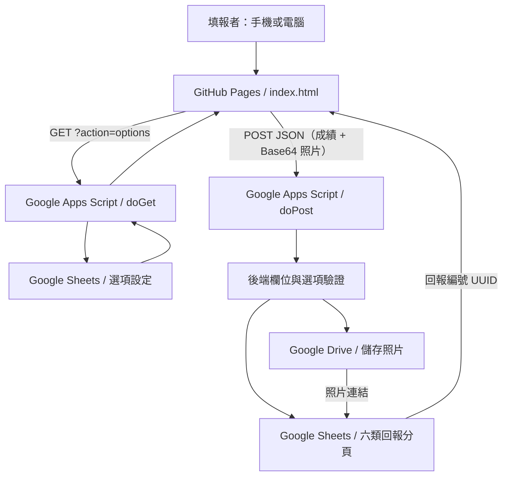

# 寶光崇正 2027 年（丁未年）白陽慈航盛會｜成績回報系統

> [!IMPORTANT]
> **目前為第一版開發原型（尚未驗收），不是正式上線公告。**
> GitHub 上有前端與後端**原始碼**，但尚未確認 Apps Script 正式部署與 GitHub 程式一致，也未完成所有六類回報、照片寫入及跨來源連線的端對端測試。請勿直接收集正式求道卡、出席表或其他個資。

## 📑 目錄

1. [專案概覽](#一專案概覽)
2. [專案網址與資源](#二專案網址與資源)
3. [回報類別與完整填寫規則](#三回報類別與完整填寫規則)
4. [成績結算辦法](#四成績結算辦法)
5. [系統架構與資料流](#五系統架構與資料流)
6. [專案檔案說明](#六專案檔案說明)
7. [Google 試算表資料結構](#七google-試算表資料結構)
8. [欄位與程式代碼對照](#八欄位與程式代碼對照)
9. [Google Drive 照片上傳設計](#九google-drive-照片上傳設計)
10. [安裝與部署教學](#十安裝與部署教學)
11. [API 技術文件](#十一api-技術文件)
12. [填報操作說明](#十二填報操作說明)
13. [測試與驗收清單](#十三測試與驗收清單)
14. [已知問題與安全注意事項](#十四已知問題與安全注意事項)
15. [開發進度與後續規劃](#十五開發進度與後續規劃)
16. [更新紀錄](#十六更新紀錄changelog)
17. [日常維護 SOP](#十七日常維護-sop)

---

## 一、專案概覽

### 1.1 設立目的

將「寶光崇正 2027 年（丁未年）白陽慈航盛會成績回報辦法」整理為可在手機或電腦操作的線上回報系統，減少人工整理各類回報資料的負擔，並保留必要的照片證明供管理人員後續核實。

### 1.2 主要目標

- 六種成績使用**同一個入口**，依選定類別呈現不同欄位。
- 前端採**逐步揭露**：初始僅顯示「回報類別」；選完顯示「國家」；選好國家後才顯示「單位」；該國只有一個單位時**自動帶入並隱藏單位欄**，直接進入「區域」（包含公堂類，仍需選區域）。
- 「國家 → 單位 → 區域」使用 Google 試算表的「國別／單位／區別」欄位資料連動，畫面名稱與資料來源名稱不同，但儲存格式不變。
- 各類回報自動分流至**同一份試算表的不同工作表分頁**。
- 需附證明的回報可選取照片，在 Google Drive 儲存檔案，試算表保存檔案連結。
- 保留原始回報時間與唯一回報編號，方便後續人工核對。
- 原始紀錄不得因頒獎結算而直接刪除；未來另設成績彙總與領獎狀態。

### 1.3 目前版本範圍

目前**已有程式碼**：響應式表單、六類欄位切換、Google 試算表選項讀取、前端照片預覽、Apps Script 接收資料與寫入工作表、照片上傳處理、基本欄位驗證、回報 UUID。

目前**沒有實作**：登入身分驗證、管理員後台、可靠的防重複回報、成績審核、排名、自動結算、獲獎歸零與跨梯次成績延續判斷。

已撰寫程式碼 **不代表已在正式環境測試通過**。

## 二、專案網址與資源

| 資源 | 網址／用途 | 目前狀態 |
| --- | --- | --- |
| GitHub 儲存庫 | [chy0205/ikt1114](https://github.com/chy0205/ikt1114) | ✅ 已存在、已提交程式碼 |
| GitHub Pages 預期網址 | [https://chy0205.github.io/ikt1114/](https://chy0205.github.io/ikt1114/) | ⚠️ 尚未確認 Pages 已開啟 |
| Google Apps Script 網頁應用程式 | [現有 /exec 網址](https://script.google.com/macros/s/AKfycbwrWACdDY07XimYM2Ul-dkIw8KeySVDnetLK4GKm7u0Dw8_-YPSY95uVO8QhhfySNh-/exec) | ⚠️ 前端已設定網址；後端部署版本尚未核實 |
| Google 試算表 | [白陽慈航成績回報](https://docs.google.com/spreadsheets/d/1ZglfWKES6sHWcn2vi9JVHXHVJImPqzcWGb_rYHaj0Uk/edit) | ✅ 已確認存在，「選項設定」已可讀取 |
| Google Drive 資料夾 | [白陽慈航成績回報](https://drive.google.com/drive/folders/1KlTFhCQhSX40oqEps8cP-BVXRNxhglUM) | ✅ 已確認存在，資料夾 ID 已寫入 GitHub 後端 |
| GitHub 修改歷史 | [Commits](https://github.com/chy0205/ikt1114/commits/main/) | ✅ 可追蹤提交記錄 |

> **安全說明**：以上資源連結不代表擁有存取權。GitHub 儲存庫是公開程式碼；**不得把照片、成績原始個資或帳號金鑰提交至 GitHub**。

## 三、回報類別與完整填寫規則

此節依提供的《白陽慈航2027年成績回報方式》整理；表中的「文件要求」與「目前程式」要分開看。

### 3.1 個人渡眾回報（`personal`）

**文件要求流程**

1. 選「個人渡眾回報」。
2. 選國別、單位、區別。
3. 輸入**引師姓名**。
4. 填寫**辦道日期**。
5. 輸入**此次渡眾人數**。
6. **上傳該求道者的求道卡照片**。

**驗證要求**：每次個人渡眾成績回報均需上傳求道卡。現在程式要求至少一張照片，但**沒有識別照片內容是否為求道卡**，需人工核實。

**預計儲存分頁**：`個人渡眾`。

### 3.2 家堂渡眾回報（`family`）

1. 選「家堂渡眾回報」。
2. 選國別、單位、區別。
3. 輸入**佛堂堂號**、**壇主姓名**。
4. 填寫**辦道日期**、**渡眾人數**。

**驗證要求**：成績結算時，請獲獎壇主提供**辦道簿資料**以核實資格。文件沒有要求每次表單提交時上傳照片，因此本版沒有照片必填欄位。

**預計儲存分頁**：`家堂渡眾`。

### 3.3 公堂渡眾回報（`public`）

1. 選「公堂渡眾回報」。
2. 選國別、單位、**區域**（新增需求，公堂類也需選區域）。
3. 輸入**回報人姓名**（2026/11/12 新增的系統欄位）及**公堂堂號**。
4. 填寫**辦道日期**、**渡眾人數**。

**驗證要求**：結算時由獲獎壇主提供辦道簿資料以核實。

**預計儲存分頁**：`公堂渡眾`。

### 3.4 個人成全進階班回報（`personalClass`）

1. 選「個人成全進階班回報」。
2. 選國別、單位、區別。
3. 選班別：**禮行、義理、仁德**。
4. 輸入**成全者姓名**及**班員姓名**。
5. 填寫**上課日期**。
6. 選第幾次上課：**1～24**。
7. **上傳該進階班的上課出席表**。

**驗證要求**：每次回報皆需上傳出席表；出席表向班期主領班索取並截圖上傳。

**預計儲存分頁**：`個人成全進階班`。

### 3.5 公堂進階班回報（`publicClass`）

1. 選「公堂進階班回報」。
2. 選國別、單位、**區域**（新增需求，公堂類也需選區域）。
3. 輸入**回報人姓名**（2026/11/12 新增的系統欄位）及**公堂堂號**。
4. 選班別：禮行、義理、仁德。
5. 輸入**堂數達標之班員人數**。
6. **上傳該進階班的上課出席表**。

**預計儲存分頁**：`公堂進階班`。原始辦法此類別未要求填寫日期或上課次數，本版遵照該欄位配置；若管理需要可於後續擴充。

### 3.6 成全安堂完成回報（`temple`）

1. 選「成全安堂完成回報」。
2. 選國別、單位、區別。
3. 輸入**成全者姓名**、**壇主姓名**。
4. 填寫**正式安堂日期**。
5. **上傳當天安堂照片，佛堂須入鏡**。

**成績認列原則**：只有**正式安堂完成**才能列入；成全安堂但尚未安堂不得計算。此條件**尚未建立自動審核功能**。

**預計儲存分頁**：`成全安堂完成`。

### 3.7 六類差異總表

| 類別 | 國別 | 單位 | 區別 | 堂號 | 姓名類欄位 | 日期 | 人數 | 班別 | 次數 | 照片必填 |
| --- | :---: | :---: | :---: | :---: | --- | :---: | :---: | :---: | :---: | :---: |
| 個人渡眾 | ✓ | ✓ | ✓ | — | 引師 | ✓ | ✓ | — | — | ✓ |
| 家堂渡眾 | ✓ | ✓ | ✓ | ✓ | 壇主 | ✓ | ✓ | — | — | — |
| 公堂渡眾 | ✓ | ✓ | ✓ | ✓ | 回報人 | ✓ | ✓ | — | — | — |
| 個人成全進階班 | ✓ | ✓ | ✓ | — | 成全者、班員 | ✓ | — | ✓ | ✓ | ✓ |
| 公堂進階班 | ✓ | ✓ | ✓ | ✓ | 回報人 | — | ✓ | ✓ | — | ✓ |
| 成全安堂完成 | ✓ | ✓ | ✓ | — | 成全者、壇主 | ✓ | — | — | — | ✓ |

## 四、成績結算辦法

以下為原始回報辦法的業務規則，**尚未在程式內自動執行**。

| 事項 | 規則 |
| --- | --- |
| 第一梯次成績結算 | **2027/05/23 23:59** 截止 |
| 第一梯次表揚 | 2027 年第一次壇主一、二班入班時表揚及頒獎 |
| 第一梯次已領獎者 | **該獎項**成績歸零，重新計算 |
| 第一梯次尚未達標者 | 成績可延續至第二梯次 |
| 第二梯次成績結算 | **2027/11/07 23:59** 截止 |
| 第二梯次表揚 | 2027 年第二次壇主一、二班入班時表揚及頒獎 |
| 年度結算 | 2027 年 11 月最後頒獎後，所有成績數字清空，公布戊申年獎勵制度 |

**開發建議（非原始辦法明訂的資料庫規則）**：

- **永久保留原始回報**；使用統計表、獎項累計表或結算快照表處理「歸零」，不要刪除原始證明與紀錄。
- 每個獎項分別記錄領獎者、領獎梯次與下次起算點。
- 訂出資料補登、退回補件、更正及重複申報審核流程。
- 以上建議在業務規則確認前**不自動執行**。

## 五、系統架構與資料流



**重要**：上圖描述**程式設計的預期流程**，不表示所有跨網域操作都已測試成功。

**GitHub Pages** 僅代管靜態前端，不能安全保存 Google Drive 編輯金鑰。**Google Apps Script** 以部署的執行身分使用試算表及 Drive 權限。試算表原始資料及照片不放在 GitHub。

## 六、專案檔案說明

```ikt1114/
├── index.html   # HTML、CSS、前端 JavaScript
├── Code.gs      # 需手動複製至 Google Apps Script 的後端程式
└── README.md    # 專案文件、操作指南、開發更新紀錄
```

### 6.1 `index.html`

包含頁面外觀、六種動態表單、`TYPES` 欄位組合、`LABEL` 顯示名稱、選項連動、照片選取預覽、上傳前驗證及 `fetch()` API 呼叫。

重要變數：

- `API_URL`：Apps Script `/exec` 網址。
- `TYPES`：每個回報類別需要呈現的欄位代碼陣列。
- `LABEL`：對使用者顯示的繁體中文欄位名稱。
- `options`：由後端讀取的 `{country, unit, district}` 組合。

目前採用純 HTML/CSS/JavaScript，**無須 Node.js 或額外套件**即可由 GitHub Pages 提供頁面。

### 6.2 `Code.gs`

主要函式：

| 名稱 | 功能 |
| --- | --- |
| `CONFIG` | 指定試算表 ID、Drive 資料夾 ID、照片數量及大小限制 |
| `TYPES` | 對應六類工作表、必要欄位、照片必填規則 |
| `HEADERS` | 其他四類沿用 A～P 共 16 欄；公堂兩類由 `PUBLIC_HEADERS` 定義專屬欄位順序 |
| `doGet(e)` | 回傳 API 基本狀態或選項資料 |
| `doPost(e)` | 接收 JSON，呼叫驗證和寫入 |
| `getOptions_()` | 讀取「選項設定」A～C 欄 |
| `validate_(p)` | 檢查回報類別、必填欄位、日期、人數、班別、上課次數與照片條件 |
| `submit_(p)` | 建立 UUID、儲存照片、追加工作表資料 |
| `safeText_(x)` | 對文字開頭特定試算表公式符號進行轉義 |
| `setupSheets()` | 建立「選項設定」及六個回報工作表（如果不存在） |

### 6.3 `README.md`

維護本頁時，**每次程式調整都要同步記錄**：台灣時間、修改檔案、功能差異、是否需要重新部署，以及測試結果。詳見第十六節。

## 七、Google 試算表資料結構

### 7.1 目前已確認的實際內容

目前這份試算表的名稱為「白陽慈航成績回報」。先前檢查時只有一個分頁：

- `選項設定`：A1＝國別、B1＝單位、C1＝區別。
- 現有可見資料為「台灣 / 中和 / 中和001」至「台灣 / 中和 / 中和011」（第 2～12 列）。

**注意**：以上是當次檢查的快照，未來資料可能新增、刪除或調整。新增選項請直接編輯工作表，不必改寫 HTML。

### 7.2 選項設定工作表

| A：國別 | B：單位 | C：區別 |
| --- | --- | --- |
| 台灣 | 中和 | 中和001 |
| 台灣 | 中和 | 中和002 |
| 台灣 | 中和 | 中和003 |
| 台灣 | 中和 | 中和004 |

上表為**資料格式範例**，不是完整名單。

**設定規則**：

1. 每列代表一個合法的「國別＋單位＋區別」組合。
2. 不要在資料中留空 A、B、C 欄；後端會忽略任一欄空白的資料列。
3. 避免合併儲存格與前後不必要的空白。
4. 國別／單位／區別名稱應統一寫法，例如「中和001」與「中和 001」會被視為不同值。
5. 同一國別可出現多個單位，同一單位可出現多個區別。
6. 公堂類表單雖不需選「區別」，選項來源仍以完整三欄資料設定為基礎。

### 7.3 六個成績工作表

`setupSheets()` 預計建立以下分頁：

1. `個人渡眾`
2. `家堂渡眾`
3. `公堂渡眾`
4. `個人成全進階班`
5. `公堂進階班`
6. `成全安堂完成`

**目前尚未確認此六個分頁已成功建立。** 如分頁已存在，`setupSheets()` 不會清空既有回報內容。

### 7.4 一般工作表 A～P（16 欄），公堂類使用專用欄位順序

| 欄 | 標題 | 資料來源／備註 |
| :---: | --- | --- |
| A | 回報編號 | 後端 `Utilities.getUuid()` 產生 |
| B | 送出時間 | 後端 `new Date()`，但目前寫入前經 `safeText_()` 轉為字串 |
| C | 回報類別 | 中文工作表名稱 |
| D | 國別 | `country` |
| E | 單位 | `unit` |
| F | 區別 | `district`，公堂類留空 |
| G | 引師姓名 | `guide` |
| H | 佛堂或公堂堂號 | `temple` |
| I | 壇主姓名 | `host` |
| J | 成全者姓名 | `mentor` |
| K | 班員姓名 | `student` |
| L | 進階班類別 | `classType` |
| M | 辦道／上課／安堂日期 | `eventDate`，目前以字串形式寫入 |
| N | 渡眾／達標人數 | `count`，目前以字串形式寫入 |
| O | 上課次數 | `session`，目前以字串形式寫入 |
| P | 照片連結 | 多張照片以換行分隔的 Drive 檔案網址 |
**公堂兩類不使用 Q 欄**。新建公堂回報分頁依填寫順序建立專用 A～K 欄：國別（D）、單位（E）、區域（F）、回報人姓名（G）依序排列：

| 欄位 | 公堂渡眾 | 公堂進階班 |
| --- | --- | --- |
| A | 回報編號 | 回報編號 |
| B | 送出時間 | 送出時間 |
| C | 回報類別 | 回報類別 |
| D | 國別 | 國別 |
| E | 單位 | 單位 |
| F | **區域** | **區域** |
| G | **回報人姓名** | **回報人姓名** |
| H | 公堂堂號 | 公堂堂號 |
| I | 辦道日期 | 進階班類別 |
| J | 渡眾人數 | 堂數達標之班員人數 |
| K | 照片連結（此類非必填） | 照片連結（必填） |

如果未來已有舊版公堂分頁資料，請先備份並檢查標題與資料相容性，再部署此版；程式**不會自動遷移既有公堂資料**。

> [!WARNING]
> 目前的 `safeText_()` 會把送出時間及數字等資料也轉成字串。**統計、排序、日期篩選前應先修正資料型態寫入邏輯**，不要把現在的欄位直接當成已完成的可計算報表。

## 八、欄位與程式代碼對照

| 程式欄位 | 中文名稱 | HTML 控制項 | 規則 |
| --- | --- | --- | --- |
| `type` | 回報類別 | 下拉選單 | 六類之一 |
| `country` | 國別 | 下拉選單 | 試算表取得 |
| `unit` | 單位 | 下拉選單 | 依國別篩選 |
| `district` | 區別 | 下拉選單 | 依國別與單位篩選 |
| `guide` | 引師姓名 | 文字輸入 | 個人渡眾必填 |
| `reporterName` | 回報人姓名 | 文字輸入 | **公堂渡眾、公堂進階班必填**（依新增需求，暫用「回報人姓名」稱呼） |
| `temple` | 佛堂／公堂堂號 | 文字輸入 | 家堂、公堂、公堂進階班 |
| `host` | 壇主姓名 | 文字輸入 | 家堂渡眾、安堂完成 |
| `mentor` | 成全者姓名 | 文字輸入 | 個人成全進階班、安堂完成 |
| `student` | 班員姓名 | 文字輸入 | 個人成全進階班 |
| `eventDate` | 辦道／上課／安堂日期 | 日期選擇器 | 對應有日期欄位的類別 |
| `count` | 渡眾／達標人數 | 數字輸入 | 後端目前允許 **0**，未限定必須大於 0 |
| `classType` | 進階班類別 | 下拉選單 | 禮行／義理／仁德 |
| `session` | 第幾次上課 | 下拉選單 | 1～24 |
| `files` | 驗證照片 | 檔案選擇器 | 特定四類強制提供至少一張 |

### 8.1 選項連動與逐步顯示

```text
國別：台灣
  └── 單位：中和
       ├── 區別：中和001
       ├── 區別：中和002
       └── 區別：中和003 ...
```

前端讀入所有有效組合，再以已選的國別、單位篩選可顯示選項。

**新版互動規則（2026/11/12）**：

1. 網頁初始**只顯示「回報類別」**，不顯示國家、單位、區域及其他資料欄位。
2. 選好回報類別後顯示「國家」，並提供來自選項設定的國家選擇。
3. 選好國家：若該國存在**多個單位**，顯示單位下拉選單；如果**只有一個單位**，系統會自動記錄該值並**跳過單位選單**。
4. 對需要區域的類別（個人渡眾、家堂渡眾、個人成全進階班、成全安堂完成），選定單位後才顯示「區域」，選好區域後才展開其餘欄位。
5. 公堂渡眾及公堂進階班**也需要區域**；單位確定後先選區域，再顯示「回報人姓名」、公堂堂號等欄位。
6. 若使用者回頭更改國家、單位或回報類別，相關依賴欄位會重新篩選或切換；未符合前置選項條件時，提交按鈕不顯示。
7. 前端顯示名稱改成「國家／區域」，後端與選項設定仍使用 `country`、`district` 和「國別／區別」，不改動現有資料值。

### 8.2 必填與驗證

- 所選回報類別的欄位均為必填。
- 進階班類別限定三種，上課次數限定整數 1～24。
- 人數必須是非負整數，**目前 0 也會通過**。
- 日期檢查格式 `YYYY-MM-DD`；程式尚未禁止未來日期，也未完整處理所有日期有效性與活動期間限制。
- 國別、單位、區別組合必須存在於「選項設定」。
- 需要照片的回報，後端至少須收到一個照片物件；照片內容真偽待人工驗證。

## 九、Google Drive 照片上傳設計

### 9.1 儲存目標

照片目標為已提供的「白陽慈航成績回報」Google Drive 資料夾。現有程式直接將照片上傳至該資料夾**根目錄**，尚未自動依國別、單位、區別、類別或日期建立子資料夾。

### 9.2 上傳格式與限制

| 項目 | 目前程式規則 |
| --- | --- |
| 檔案型別 | JPEG、PNG、WebP、HEIC、HEIF |
| 單張大小 | 5 MiB（5 × 1024 × 1024 bytes）以內 |
| 單次數量 | 最多 5 張 |
| 必填類別 | 個人渡眾、個人成全進階班、公堂進階班、成全安堂完成 |
| 傳送方法 | 瀏覽器以 Base64 字串包含於 JSON 中 |
| Drive 檔名 | `{回報UUID}_{照片序號}.{副檔名}` |
| 試算表紀錄 | P 欄以換行連接多個檔案網址 |

### 9.3 照片上傳的實際流程

1. 填報者選取照片；前端使用 `FileReader` 讀取，於頁面上呈現縮圖。
2. 點「確認送出」後，前端檢查張數、MIME 類型及大小。
3. 前端把照片轉為 Base64 放進 `files` 陣列。
4. Apps Script 再次檢查，將 Base64 解碼成二進位資料。
5. Drive 建立照片檔案，取得網址。
6. 試算表 P 欄儲存網址，並與其他回報資料一起追加一列。

### 9.4 照片安全與故障注意

- **不要把 Drive 資料夾設成「知道連結的任何人可檢視」**；先前檢查到此資料夾存在「anyone / reader」分享設定。請由管理者調整並重新核實。
- 一般上傳者不需取得 Drive 資料夾的編輯權限；寫入應由受控後端執行。
- 如果部分照片已建立、後續照片或試算表寫入卻失敗，**目前沒有交易回滾功能，可能產生孤兒照片**。
- 瀏覽器、Apps Script、Google 服務均有請求或執行限制；每張未超過 5 MiB 並不保證五張可以一次成功。
- 不可將求道卡或出席表內容用於非原定回報／核實用途；應訂定資料保留及刪除期限。
- HEIC／HEIF 的瀏覽器 MIME 判斷與預覽能力因裝置而異，需實機測試。

## 十、安裝與部署教學

> [!CAUTION]
> 正式部署前，請先使用**不含真實個資**的測試資料執行完整驗收，並確認取得適當蒐集、使用與存放照片的同意／授權。

### 10.1 建立／檢查 Google 試算表

1. 開啟 [現有試算表](https://docs.google.com/spreadsheets/d/1ZglfWKES6sHWcn2vi9JVHXHVJImPqzcWGb_rYHaj0Uk/edit)。
2. 確認有 `選項設定` 分頁。
3. 確認 A1、B1、C1 分別是 `國別`、`單位`、`區別`。
4. 從第二列開始輸入合法組合；不需要手動對所有回報類別建立選單。
5. 避免任意修改六個回報分頁的第一列欄名與欄位順序。**公堂兩類採各自 A～K 的欄位順序**；「區域」在 F 欄，「回報人姓名」在 G 欄，不再放 Q 欄。其他四類沿用 A～P，資料不受影響。

### 10.2 準備照片資料夾

1. 開啟 [指定 Google Drive 資料夾](https://drive.google.com/drive/folders/1KlTFhCQhSX40oqEps8cP-BVXRNxhglUM)。
2. 資料夾名稱可自行管理，但**不要擅自變更程式中的資料夾 ID**。
3. 檢查「共用」→「一般存取權」設為**受限制**，僅分享給必要的管理者。
4. 確認 Apps Script 的執行身分對資料夾有建立檔案權限。

### 10.3 更新 Apps Script 原始碼

1. 到 [Apps Script](https://script.google.com/home) 開啟原本的專案。
2. 打開 GitHub [`Code.gs`](https://github.com/chy0205/ikt1114/blob/main/Code.gs)，**複製完整內容**。
3. 將 Apps Script 編輯器中的對應檔案更新為 GitHub 最新版，儲存。
4. 確認 `CONFIG`：

```javascript
const CONFIG = {
  SPREADSHEET_ID: '1ZglfWKES6sHWcn2vi9JVHXHVJImPqzcWGb_rYHaj0Uk',
  DRIVE_FOLDER_ID: '1KlTFhCQhSX40oqEps8cP-BVXRNxhglUM',
  MAX_FILES: 5,
  MAX_FILE_BYTES: 5 * 1024 * 1024,
};
```

5. 在函式下拉選單選 `setupSheets`，按執行。
6. 第一次執行需依 Google 提示授予必要的試算表及 Drive 存取權。
7. 返回試算表，確認**其他四類**沿用 A～P 標題；**公堂渡眾和公堂進階班**使用專屬 A～K 欄位，F1 為「區域」，G1 為「回報人姓名」。

**提醒**：`setupSheets` 建立分頁，不會測試實際 `doPost` 上傳照片是否可用。

### 10.4 更新 Apps Script 網頁應用程式部署

1. 選「部署」→「管理部署作業」。
2. 找到現有網頁應用程式部署，按編輯。
3. 將版本選為新的版本（不要只儲存編輯器程式碼卻沒更新部署版本）。
4. 確認執行身分及存取範圍。公開匿名接收上傳存在個資與濫用風險，**未建立安全控管前不建議正式開放所有人**。
5. 完成後複製有效的 `/exec` URL。
6. 開啟 `/exec?action=options` 測試是否取得預期 JSON。

> Apps Script 的執行身分決定能使用誰的權限寫入試算表、Drive。變更部署存取權前，請確認組織的安全與個資政策。

### 10.5 GitHub Pages 設定

1. 進入 [`chy0205/ikt1114`](https://github.com/chy0205/ikt1114)。
2. 選 **Settings** → **Pages**。
3. Source 使用 **Deploy from a branch**。
4. Branch：`main`，資料夾：`/(root)`。
5. 按 **Save**，等待 GitHub 顯示公開網站網址；以實際網站能正常載入為準。
6. 查看 [`index.html`](https://github.com/chy0205/ikt1114/blob/main/index.html) 的 `API_URL` 是否與目前 Apps Script 部署網址相符。

### 10.6 正式驗收前必做

- 測試從外部網路（不是只有 Apps Script 擁有者的瀏覽器）可否載入選項。
- 測試上傳含一張小型測試圖片的合法回報是否能成功。
- 檢查六類資料是否寫入**正確**分頁，且照片網址僅可由受權管理者開啟。
- 測試失敗、逾時、重送時資料會不會被重複寫入。
- 確認所有個資保護與核實工作流程後才發布給填報者。

## 十一、API 技術文件

### 11.1 GET：服務狀態

```http
GET /exec
```

程式預期回傳：

```json
{"ok":true,"message":"白陽慈航2027 API 已啟用"}
```

此結果只證明程式入口可回應，不代表試算表或 Drive 權限正常。

### 11.2 GET：讀取選項

```http
GET /exec?action=options
```

預期 JSON 格式：

```json
{
  "ok": true,
  "options": [
    {"country":"台灣","unit":"中和","district":"中和001"},
    {"country":"台灣","unit":"中和","district":"中和002"}
  ]
}
```

實際內容以「選項設定」分頁為準。若未找到分頁、權限不足等，`getOptions_()` 可能拋出例外；目前 `doGet` 尚未使用一致的錯誤 JSON 包裝。

### 11.3 POST：提交成績

```http
POST /exec
Content-Type: text/plain;charset=utf-8
```

資料為 JSON 字串；下列範例只展示**不需照片**的家堂渡眾回報：

```json
{
  "type": "family",
  "country": "台灣",
  "unit": "中和",
  "district": "中和001",
  "temple": "測試佛堂",
  "host": "測試壇主",
  "eventDate": "2027-01-15",
  "count": "2",
  "files": []
}
```

需照片的類別會傳送 `files` 陣列，每個項目包含 `mimeType` 與 `data`（Base64 原始內容）。

**程式預期的成功回應**：

```json
{"ok":true,"id":"產生的 UUID"}
```

**程式預期的錯誤回應**：

```json
{"ok":false,"error":"錯誤原因"}
```

### 11.4 各類後端 type 值

| type | 工作表 |
| --- | --- |
| `personal` | 個人渡眾 |
| `family` | 家堂渡眾 |
| `public` | 公堂渡眾 |
| `personalClass` | 個人成全進階班 |
| `publicClass` | 公堂進階班 |
| `temple` | 成全安堂完成 |

### 11.5 技術限制

- Apps Script `ContentService` 可能透過重新導向提供輸出；GitHub Pages 端的 `fetch` 可能遇到跨來源（CORS）政策，**必須實際測試**。
- 本 API 尚無身分驗證、流量限制、伺服器端防重複提交碼或資料審核。
- 「成功」應以**工作表新增一列且照片實際存在**為最終判定，不能只依瀏覽器提示判定。
- 回報編號由後端產生，尚未提供依編號查詢回報狀態的 API。

## 十二、填報操作說明

### 12.1 一般填報者

1. 用手機或電腦開啟成績回報網站。
2. 選擇六種回報類別之一。
3. 依序選擇國別、單位、區別（若該類別有區別欄）。
4. 填完該類別要求的姓名、堂號、日期、人數／班別／上課次數。
5. 需要驗證照片的類別，選取正確照片並檢查縮圖。
6. 核對內容後點「確認送出」一次。
7. 如畫面顯示成功及回報編號，保存該編號供管理者查詢。
8. 若顯示網路或上傳錯誤，**先詢問管理者是否已收到紀錄，不要直接連續重複送出**。

### 12.2 管理者

1. 開啟試算表，找到對應回報類別的分頁。
2. 檢查回報編號、時間、回報資料、照片網址。
3. 使用具備權限的 Google 帳號開啟驗證照片。
4. 依照原始辦法核實求道卡、出席表、正式安堂照片或結算時的辦道簿。
5. 需要更正或排除重複時，先留下審核紀錄；不要直接刪除原始資料而失去查核依據。

## 十三、測試與驗收清單

> **全部先列為待測**。此清單是測試規劃，不代表已通過。

### 13.1 環境與選項

- [ ] GitHub Pages 可以開啟，行動版版面正常。
- [ ] `GET /exec` 回傳預期 API 訊息。
- [ ] `GET /exec?action=options` 回傳 JSON。
- [ ] 初始只顯示「回報類別」，選類別後才顯示「國家」。
- [ ] 國家有多個單位時，顯示單位選單。
- [ ] 國家只有一個單位時，自動帶入且**不顯示單位選單**，直接顯示區域或後續欄位。
- [ ] 需要區域的類別必須先選區域才展開其餘欄位；公堂兩類也需要區域。
- [ ] 更改國家／單位後，依賴選項能正確重新篩選。
- [ ] 切換回報類別後欄位正確。
- [ ] 選項表新增或刪除一列後重新整理，網頁能顯示更新。

### 13.2 六類回報

- [ ] 個人渡眾：全部欄位、求道卡照片、正確寫入。
- [ ] 家堂渡眾：無須照片、辦道簿留待結算核對。
- [ ] 公堂渡眾：必須選區域、回報人姓名必填、資料依順序寫入 F 欄區域和 G 欄姓名。
- [ ] 個人成全進階班：禮行／義理／仁德、1～24、出席表。
- [ ] 公堂進階班：必須選區域、回報人姓名必填、達標人數與出席表正確寫入。
- [ ] 成全安堂完成：正式日期、佛堂入鏡照片、人工核實。

### 13.3 照片、資料與例外

- [ ] 無照片時需要照片的類別無法提交。
- [ ] 一張照片成功儲存、可在 Drive 找到。
- [ ] 多張照片的網址正確寫在同一列 P 欄。
- [ ] 超過 5 張、單張大於 5 MiB 時有正確錯誤訊息。
- [ ] 不支援 MIME 格式時拒絕。
- [ ] 非法選項、缺少必填欄位、人數不是整數時拒絕。
- [ ] 一次點擊後按鈕暫時鎖定。
- [ ] 重送／網路中斷不產生無法辨識的重複回報。
- [ ] Drive 權限不向非管理者公開照片。
- [ ] 照片成功但寫表失敗時有清理／管理處理流程。
- [ ] 日期、人數、次數欄位的資料型態可支援未來統計。
- [ ] Chrome、Safari、Android、iPhone 實機測試。
- [ ] 所有測試資料與測試照片已清理。

## 十四、已知問題與安全注意事項

| 優先程度 | 項目 | 現況／風險 | 建議處理 |
| --- | --- | --- | --- |
| 高 | 個人資料與照片公開權限 | Drive 資料夾先前檢查到 `anyone: reader` | 調整為受限制，確認檔案個別權限及保留期限 |
| 高 | 無身分驗證 | 匿名 API 可遭冒用或濫用 | 加入回報授權、管理者審核、限流及異常偵測 |
| 高 | CORS／重新導向 | GitHub Pages 向 Apps Script 傳送不一定能正常讀取回應 | 實測；必要時改 Apps Script HTML Service 或支援 CORS 的後端 |
| 高 | 同一回報重複送出 | 只有前端按鈕鎖定，伺服器沒有冪等機制 | 增加用戶端請求 ID、伺服器唯一鍵和狀態查詢 |
| 中 | 資料型態 | `safeText_()` 將日期、數值及時間轉為文字 | 保留原生時間／數字，只對文字進行轉義 |
| 中 | 照片部分成功 | 先建立 Drive 照片，最後才寫入試算表 | 失敗清理、部分成功狀態與管理工具 |
| 中 | 日期與人數規則 | 現有程式允許人數 0，未全面阻止未來日期 | 依業務需求確認規則後加強驗證 |
| 中 | 資料內容核實 | 程式不辨識求道卡、出席表或佛堂是否入鏡 | 人工審核及退件流程 |
| 中 | 程式碼／部署不同步 | GitHub 改版不會自動更新 Apps Script | 設定發版 SOP，必要時導入 clasp |
| 低 | UI 欄位名稱 | 多類日期、人數、堂號使用共用標籤 | 依類別顯示更精確的欄位文字 |
| 低 | 進階統計 | 無年度獎項結算、跨梯次計分 | 後續規劃統計與獎項模組 |

### 14.1 不可做的事

- 不要公開分享可直接瀏覽個資的試算表或驗證照片資料夾。
- 不要在 GitHub 提交真實求道卡、出席表或敏感資料。
- 不要在沒測試的情況下宣稱已正式可用。
- 不要將第一梯次歸零解讀為**刪除全部原始回報**。
- 不要直接拿公開的 `/exec` API 作為已具備安全性的證明。

## 十五、開發進度與後續規劃

### 15.1 已完成的程式碼工作

- [x] 建立 GitHub 專案並提交三個檔案。
- [x] 六種類別的前端欄位切換，並改成「類別 → 國家 → 單位（若只有一個則略過）→ 區域（部分類別）→ 詳細內容」。
- [x] 國別／單位／區別的前端連動程式。
- [x] Apps Script 的選項讀取與六類寫入程式，公堂兩類新增必填「回報人姓名」，依各自欄位順序寫入 F 欄，不使用 Q 欄。
- [x] 照片上傳與 Drive 儲存程式碼。
- [x] 設定前端 Apps Script 網址。
- [x] 在 GitHub 後端設定試算表及資料夾 ID。
- [x] 建立開發文件及變更紀錄。

### 15.2 未完成的環境驗證

- [ ] 確認 GitHub Pages 成功部署。
- [ ] 同步最新 `Code.gs` 到 Apps Script，並更新現有部署版本。
- [ ] 執行 `setupSheets()`、確認六個分頁及欄名。
- [ ] 完成 GET 選項及 POST 寫入測試。
- [ ] 實測 Drive 照片上傳和檢視權限。
- [ ] 實測 iPhone／Android／桌面瀏覽器。
- [ ] 明確建立上線前的安全審核與驗收結論。

### 15.3 下一階段建議功能（**尚未實作**）

1. **管理者審核**：待審核、已通過、退回補件、作廢；保留操作人員與時間。
2. **統計總覽**：依國別、單位、區別、回報類別、時間區間統計。
3. **雙梯次結算**：獨立追蹤各獎項的起算點、得獎者、已領／未領與結算快照。
4. **防重複／補登機制**：回報唯一鍵、補件更新、版本紀錄。
5. **照片整理**：依年度、類別、國別、單位建立資料夾，支援搜尋與權限管理。
6. **填報體驗**：精確欄位標籤、照片壓縮、多張上傳進度、草稿與成功確認頁。
7. **通知機制**：管理員回報通知、異常提交提醒；須先確定通知管道。
8. **安全控管**：登入／限流／權限分級／最小化資料蒐集／刪除時程。

## 十六、更新紀錄（Changelog）

### 紀錄原則

- 時區固定：**Asia/Taipei（UTC+8）**。
- 採用 **`YYYY/MM/DD HH:mm:ss`** 記錄 GitHub Commit 的建立時間；不憑印象編造精確時刻。
- 每次維護以**最新在上、最舊在下**的順序記錄。
- 必須描述：更新時間、修改檔案、修改內容、影響、是否需要重新部署、測試狀態與 Commit。
- 程式碼提交、Apps Script 正式部署、功能實測成功，**是三件不同的事**。
- 若尚未有可靠時間或驗證結果，標為「待確認」，不可自行填寫通過。

### 2026/11/12｜補回公堂兩類的「區域」欄位

- **問題來源**：使用者實際開啟公堂渡眾網頁時，選國家後沒有看到區域，直接跳出回報人姓名。這是因為先前公堂兩類的欄位設定刻意省略了 `district`。
- **本次修正**：`index.html` 和 `Code.gs` 的 `public`、`publicClass` 均在「單位」與「回報人姓名」之間加入 `district`，前端必須選完區域才顯示後續欄位與提交按鈕；後端也檢查區域是否存在於「選項設定」。
- **單一單位規則不變**：若該國只有一個單位，會自動帶入並跳過單位選單，直接顯示「區域」選擇。
- **儲存順序**：公堂兩類專用工作表調整為 A～K：A 回報編號、B 送出時間、C 回報類別、D 國別、E 單位、F 區域、G 回報人姓名、H 公堂堂號、I/J 為該類其他欄位、K 照片連結。**不使用 Q 欄**。
- **與原始文件差異**：最初辦法中的公堂類沒有要求區別；本次是依使用者後續指示新增，後續以新版系統規格為準。
- **部署注意**：GitHub Pages 的 HTML 更新後可重新載入；但 Apps Script 必須手動同步最新 `Code.gs` 並重新部署才能接收區域資料。
- **驗證狀態**：已提交程式碼，尚未使用真實回報完成端對端驗證。
- **GitHub commits**：[前端](https://github.com/chy0205/ikt1114/commit/ca2e51a44fbbf9f50b8d0ccd45b3ec21a69e655f)、[後端](https://github.com/chy0205/ikt1114/commit/46438523ca8e8dd107ca7ec52ade6ce20f239b6a)。

### 2026/11/12｜修正公堂姓名儲存順序（依使用者確認）

- **調整原因**：公堂渡眾及公堂進階班的「回報人姓名」應依表單原本的欄位順序儲存，**不應統一放到 Q 欄**。
- **修正內容**：更新 `Code.gs`，增加 `PUBLIC_HEADERS` 與 `rowFor_()`，公堂兩類獨立使用 A～J 欄：回報編號、送出時間、回報類別、國別、單位、回報人姓名、公堂堂號、後續類別欄位、照片連結。
- **影響**：僅公堂兩類的工作表資料順序；其他四類仍沿用既有 A～P 欄位，不改動前端欄位顯示順序。
- **資料保護**：未直接修改 Google 試算表既有資料；若有早期公堂回報資料，先核對並備份，再考慮資料搬移。
- **部署需求**：**需將最新版 Code.gs 同步至 Apps Script，建立新部署版本**。
- **測試狀態**：GitHub 原始碼已提交，實際寫入尚待驗證。
- **修改紀錄**：[GitHub Commit](https://github.com/chy0205/ikt1114/commit/a828169be5edc661a83f948a714e51f14d479266)（確切提交時間以 GitHub 顯示為準）。

### 2026/11/12｜分段式表單流程與公堂回報姓名（第二版介面調整）

**本次需求**：初始只顯示回報類別，逐步顯示國家、單位、區域；只有一個單位時自動帶入並直接進入區域；公堂渡眾與公堂進階班新增姓名欄位。

| 更新時間（台灣時間） | 異動內容 | 檔案／Commit | 部署及驗證 |
| --- | --- | --- | --- |
| 2026/11/12 07:05:15 | 修改前端為逐步顯示；公堂兩類新增「回報人姓名」輸入欄位。 | [`index.html`](https://github.com/chy0205/ikt1114/commit/d55946040d997c1dba3d2785f3915113dbbc4a62) | GitHub 原始碼已更新；前端實際顯示待驗證 |
| 2026/11/12 07:05:32 | 當時版本曾將公堂兩類回報人姓名設於 Q 欄（**已由後續更新取代**）。 | [`Code.gs`](https://github.com/chy0205/ikt1114/commit/8e5ec2e1d256dc91c50a1d0c2891c6b380d0a350) | **必須重新同步及部署 Apps Script**；尚未端對端測試 |
| 2026/11/12 07:05:56 | 單一單位不只自動帶入，還會**隱藏單位選單**，讓使用者直接選區域（公堂類直接進入填報）。 | [`index.html`](https://github.com/chy0205/ikt1114/commit/905e9f8c9aefc203fd4eebc99f0715cd2097338e) | GitHub 原始碼已更新，待頁面實測 |

**資料相容性**：

- 不修改現有「選項設定」的國別、單位、區別欄位名稱或資料。
- 其他四類成績分頁的 A～P 原樣保留。**公堂兩類不新增 Q 欄**，採 A～J 的專用順序，回報人姓名在 F 欄。
- 姓名目前定義為**「回報人姓名」**，不推斷為壇主姓名或求道者姓名；若實際要的是其他身分，後續調整欄位名稱與用途。
- 前端與後端程式都已修改，但 **GitHub 不會同步更新 Apps Script 已部署版本**，新版後端必須由管理員重新部署。
- 本次不更動 Google 試算表既有回報紀錄，不實際上傳照片，也不提交測試成績。

### 2026/11/12｜第一版開發與介接配置

| 更新時間（台灣時間） | 更新內容 | 影響檔案／Commit |
| --- | --- | --- |
| 2026/11/12 06:31:44 | 設定照片上傳使用的 Google Drive 資料夾 ID。 | [`Code.gs`](https://github.com/chy0205/ikt1114/commit/ce4c8d30cfd72f28e1eea1398e1dd0108ce3ff40) |
| 2026/11/12 06:29:49 | 設定成績回報使用的 Google 試算表 ID。 | [`Code.gs`](https://github.com/chy0205/ikt1114/commit/a023ac7b02e55c79004b1e0d9426995c573cb6fd) |
| 2026/11/12 06:28:28 | 將現有 Google Apps Script `/exec` 網址填入前端 API 設定。 | [`index.html`](https://github.com/chy0205/ikt1114/commit/573f44fbd5add294195bb2ac4b56cbb9c8a6b8c9) |
| 2026/11/12 06:27:42 | 建立第一版專案說明與部署步驟。 | [`README.md`](https://github.com/chy0205/ikt1114/commit/1ed2cd93cf94d7dec3c91ce6297b4dc541fea2c3) |
| 2026/11/12 06:27:39 | 建立 Apps Script 後端：選項讀取、六類工作表寫入、照片儲存與初始化功能。 | [`Code.gs`](https://github.com/chy0205/ikt1114/commit/deedbe1ff890a8ba9c701f31a6c3e5bc397fdb7e) |
| 2026/11/12 06:27:37 | 建立第一版響應式 HTML 表單與六種回報欄位。 | [`index.html`](https://github.com/chy0205/ikt1114/commit/748c4e0937222a0aaa8547ae76d69e232fe9acde) |

#### 第一版各次變更詳解

**06:27:37｜建立前端網頁**

- 新增回報入口與六種回報類別。
- 使用同一份 HTML、CSS、JavaScript 呈現動態欄位。
- 實作選項載入、照片縮圖、欄位驗證、提交狀態顯示。
- 影響：`index.html`；**GitHub Pages 是否成功公開仍需核實**。

**06:27:39｜建立 Apps Script 後端**

- 定義 `CONFIG`、`TYPES`、`HEADERS`。
- 新增 `doGet`、`doPost`、`getOptions_`、`validate_`、`submit_`、`setupSheets`。
- 目標是將照片存 Drive、成績按類別存 Sheets。
- 影響：`Code.gs`；**仍需在 Apps Script 專案部署及端對端驗證**。

**06:27:42｜加入初版 README**

- 提供簡易部署及隱私提醒。
- 後續擴充為完整專案技術文件。

**06:28:28｜設定前端 API**

- 用提供的 Apps Script `/exec` 網址替換 `API_URL`。
- 影響：`index.html`；不等於 API 已測試成功。

**06:29:49｜設定 Google 試算表**

- 將實際試算表 ID 寫入後端 `CONFIG.SPREADSHEET_ID`。
- 已確認試算表存在且有「選項設定」分頁。
- 影響：`Code.gs`；**需同步更新 Apps Script 部署**。

**06:31:44｜設定 Google Drive**

- 將照片資料夾 ID 寫入 `CONFIG.DRIVE_FOLDER_ID`。
- 已確認資料夾存在，但需要限制分享權限。
- 影響：`Code.gs`；**需同步更新 Apps Script 部署**。

### 2026/11/12｜文件維護

- 將初版 README 擴充為具日期、影響檔案、連結與部署狀態的基本更新紀錄。
- 本次再擴充為**完整技術文件、使用指南、回報欄位矩陣、API 規格、測試清單、安全風險與 SOP**。
- 僅修改 `README.md`，**沒有修改前端／後端執行邏輯**。
- 詳細時間與本次提交 SHA 請以 [GitHub 提交歷史](https://github.com/chy0205/ikt1114/commits/main/) 為準；不在編輯前猜測本次 Commit 時間。

### 往後新增更新的格式

```markdown
### YYYY/MM/DD HH:mm:ss（台灣時間）｜版本／更新名稱

- **修改檔案**：index.html、Code.gs、README.md
- **原本狀況**：
- **修改內容**：
- **影響範圍**：
- **資料結構是否變動**：是／否（如有請列欄位）
- **是否需重新部署 Apps Script**：是／否
- **是否需重新部署 GitHub Pages**：是／否
- **測試狀態**：待測／部分通過／全部通過
- **已知問題／回復方式**：
- **Commit**：[SHA](GitHub Commit URL)
```

完整原始記錄：[GitHub Commit History](https://github.com/chy0205/ikt1114/commits/main/)。

## 十七、日常維護 SOP

### 17.1 新增國別、單位或區別

1. 開啟「選項設定」分頁。
2. 在新列輸入**完整**的國別、單位、區別組合。
3. 檢查沒有多餘空白與重複名稱。
4. 重新整理前端網頁，確認選單出現新值。
5. 一般不需更新 GitHub 程式（除非欄位規則改變）。

### 17.2 修改表單欄位

1. 在 `index.html` 修改對應 `TYPES` 與 `LABEL`，必要時修改 `field()`。
2. 在 `Code.gs` 修改相同類別的 `TYPES`、`validate_`、`submit_` 與 `HEADERS`。
3. 如新增試算表欄位，先規劃既有資料的相容與遷移，不要直接破壞歷史資料。
4. 提交 GitHub Commit，更新 README Changelog。
5. 手動將新的 `Code.gs` 同步到 Apps Script，更新正式部署版本。
6. 重新測試受影響的回報類別及未受影響的類別（回歸測試）。

### 17.3 程式改版與回復

1. 改版前記錄 GitHub Commit SHA 與當前 Apps Script 部署版本。
2. 先用**非正式測試資料**驗證。
3. 發布後檢查試算表新增資料與照片結果。
4. 出錯時，先停止接受真實回報或通知使用者暫停，避免資料重複。
5. 以 GitHub 歷史還原前端／後端原始碼，並記得 Apps Script 須重新部署上一個可用版本。
6. 更新 README 說明事故、修正、測試及恢復時間。

### 17.4 每日或每梯次資料管理

- 定期查看六個分頁是否有異常回報、重複資料或缺照片。
- 依原始辦法核對憑證與達標資格。
- 每梯次結算前保留資料備份與核實結果。
- 結算調整以**另外的統計或審核紀錄**進行，不直接抹除原始成績。
- 定期審查 Drive 及試算表分享權限，避免不必要的人員持續存取。

---

**維護原則：詳細記錄每一次修改、保留可追溯的 Commit、區分已寫程式與已上線驗證、優先保護個資。**
